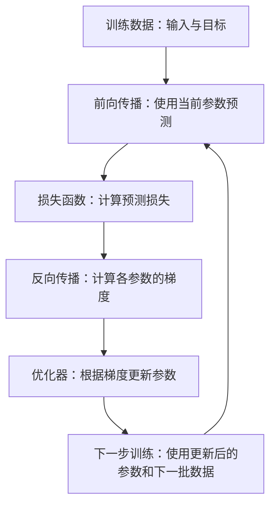

# 大模型训练：参数更新为什么能让模型学到规律？

> 本文收录于 [AI-Engineering-Notes](https://github.com/xallor-ai/AI-Engineering-Notes)，分享大模型原理、AI 工程实践与应用探索。欢迎 Star 关注后续更新，也欢迎通过 Issue 交流和纠错。

理解大模型训练时，我最初遇到的问题是：**微分为什么能用来优化？**

随后，我逐渐知道，导数能描述参数变化对损失的影响；反向传播负责计算梯度，优化器负责更新参数。但理解了这些步骤，另一个问题反而变得更明显了：

**没有人告诉模型每个参数应该是多少，为什么不断调整参数，它就能学会数据中的东西？**

这篇文章沿着这条提问路径展开。我们先看训练怎样发生，再解释参数变化为什么可能带来学习，以及这种解释有哪些边界。

这里主要讨论自回归语言模型通过预测下一个 Token 进行预训练的基本过程。它是理解大模型训练的起点，并不涵盖所有后续训练方式。

## 01. 模型究竟发生了什么变化？

假设训练文本是：

> 今天天气很好。

在其中一个预测位置，我们给模型的输入是“今天天气很”，目标是接下来的“好”。为便于说明，假设这里的“好”是一个 Token；实际 Token 划分由分词器决定，并不总是一个汉字对应一个 Token。

模型计算的结果，是词表中各个 Token 成为下一个 Token 的概率。例如：

| 候选 Token | 某次预测分配的概率 |
| --- | ---: |
| 好 | 20% |
| 冷 | 15% |
| 热 | 10% |
| 其余 Token 合计 | 55% |

这些数字只是示意。模型通过内部计算，把上下文转换成了一个概率分布。

决定这种转换方式的，是模型内部大量可调整的**参数**，例如神经网络中的权重。参数不同，同样的输入就可能得到不同的预测概率。

训练所做的，就是使用数据反复调整这些参数，希望模型在训练任务上的整体预测表现变好。

这里还有一个容易忽略的问题：正确答案从哪里来？

对于下一个 Token 预测，文本本身就能提供目标。给定前面的 Token，后面的那个 Token 就是这个位置的训练目标。一段文本可以提供许多个这样的预测位置。

在常见的 Transformer 语言模型训练中，可以并行计算一段序列中多个位置的预测。输入位置 $t$ 只能利用该位置及之前的信息，用来预测位置 $t+1$ 的 Token；**因果注意力掩码**阻止它利用后续信息。因此，即使整段文本被一起送入模型，负责预测“好”的位置也不能直接看到“好”。

因此，这类训练不需要人为给每个位置另写一个答案，通常称为**自监督学习**。

不过，文本提供目标，只解决了“应该预测什么”。接下来还需要知道：模型现在预测得怎么样？

## 02. 损失函数怎样判断预测得好不好？

对于同一个输入“今天天气很”和同一个目标“好”，假设模型在两次不同的参数状态下，分别给“好”分配了 20% 和 80% 的概率。

即使两次“好”都是概率最高的候选，它们也不是同样好的预测：第二次给当前训练目标分配的概率更高。

我们需要一个能量化这种差别的指标，这就是**损失函数（Loss Function）**。

在常见的下一个 Token 预测训练中，单个位置的交叉熵损失可以写成：

$$
L=-\ln p_{\theta}(y\mid c)
$$

这里，$c$ 是上下文，$y$ 是训练文本中的目标 Token，$\theta$ 是模型参数，$p_{\theta}(y\mid c)$ 是模型给这个目标分配的概率。

不必深入研究对数，只需看它产生的效果：

| 给目标 Token 的概率 | 损失 $-\ln p$，约值 |
| --- | ---: |
| 20% | 1.609 |
| 80% | 0.223 |

**对同一个训练目标，分配的概率越高，这个位置的损失就越小。** 实际训练通常会汇总一批样本中多个预测位置的损失，再进行优化。

也要注意，“好”是这条训练文本里实际出现的后续，不意味着“冷”“热”等其他续写在语言上都不成立。模型会在大量不同文本中接收到不同的目标信号，学习上下文与后续内容之间的统计关系。

损失值告诉我们当前预测与训练目标的匹配程度，但只知道“损失很大”还不够。

如果模型有数十亿个参数，应该改哪一个？增加还是减小？每次改多少？

## 03. 微分为什么能帮助我们找到调整方向？

暂时把庞大的模型放到一边，先看只有一个变量的函数：

$$
f(x)=x^2
$$

假设现在 $x=3$，函数值是 $9$。我们希望函数值变小，应该增加 $x$，还是减小 $x$？

对函数求导：

$$
f'(x)=2x,\qquad f'(3)=6
$$

这个 $6$ 描述了当前位置的局部变化率。对于足够小的变化 $\Delta x$，有：

$$
\Delta f\approx f'(x)\Delta x
$$

在 $x=3$ 附近，稍微增加 $x$，函数值就会增加；稍微减小 $x$，函数值就会减小。

严格来说，导数是变化率，而微分 $df=f'(x)\,dx$ 描述了函数变化的一阶线性近似。它们为优化提供变化信息，真正选择调整步骤的是优化算法。

一种直接的更新方式，就是沿导数的反方向移动：

$$
x_{\text{new}}=x_{\text{old}}-\eta f'(x_{\text{old}})
$$

其中 $\eta$ 是**学习率**，用于控制更新幅度。取 $\eta=0.1$，从 $x_0=3$ 开始：

| 更新次数 | 当前 x | 导数 2x | 函数值 x² |
| --- | ---: | ---: | ---: |
| 0 | 3.0000 | 6.0000 | 9.0000 |
| 1 | 2.4000 | 4.8000 | 5.7600 |
| 2 | 1.9200 | 3.8400 | 3.6864 |
| 3 | 1.5360 | 3.0720 | 2.3593 |
| 4 | 1.2288 | 2.4576 | 1.5099 |

每次更新后，重新计算新位置的导数，然后继续调整。这里的 $x$ 逐渐接近 $0$，函数值也逐渐接近最小值 $0$。

这就是**梯度下降**在单变量情况下的样子。

“局部”这个限制很重要。下降方向描述的是当前位置附近的变化，步子太大仍然可能让函数值上升。例如，同样从 $x=3$ 出发，若学习率取 $2$，新位置就会变成 $-9$，函数值反而从 $9$ 增大到 $81$。

现在回到模型。模型有很多参数，我们把它们放进向量 $\theta$。损失对每个参数的偏导数组成的向量，叫作**梯度（Gradient）**：

$$
\nabla L(\theta)=\left(\frac{\partial L}{\partial\theta_1},\ldots,\frac{\partial L}{\partial\theta_n}\right)
$$

每个分量描述：在其他参数暂时固定时，稍微改变这个参数，损失会怎样变化。

对于可微函数，在通常的欧氏距离度量下，非零梯度指向局部增长最快的方向，负梯度则指向局部下降最快的方向。梯度为零也不一定意味着找到了最小值，还可能遇到极大值或鞍点。

我们现在知道了更新需要什么信息，但还有一个实际问题：怎样计算那么多参数的梯度？

## 04. 反向传播和优化器，分别负责什么？

神经网络通过多层计算产生预测。某个参数可能先改变中间结果，中间结果再影响下一层，最后才影响损失。

要计算这个参数对损失的影响，需要把沿途的影响连接起来。数学上的工具叫作**链式法则**。

例如，假设某段计算是 $z=wx$，然后用 $z$ 计算损失，那么：

$$
\frac{\partial L}{\partial w}
=\frac{\partial L}{\partial z}\frac{\partial z}{\partial w}
=\frac{\partial L}{\partial z}x
$$

**反向传播**（Backpropagation）沿计算图从损失往回计算，利用链式法则逐层计算各个参数的梯度。计算过程中会复用前向传播保存的中间结果，避免重复计算，提高梯度计算效率。

这里“往回”指的是计算影响关系的顺序。反向传播算出梯度之后，参数还没有因此自动更新；更新是优化器负责的另一件事。

三个角色可以这样区分：

| 角色 | 负责什么 |
| --- | --- |
| 损失函数 | 把预测与训练目标的匹配程度转化成一个数值 |
| 反向传播 | 计算损失对各个参数的梯度 |
| 优化器 | 利用梯度等信息，实际更新参数 |

如果使用最基本的梯度下降，参数更新可以写成：

$$
\theta_{\text{new}}=\theta_{\text{old}}-\eta\nabla L(\theta_{\text{old}})
$$

实际训练中的优化器，例如 AdamW，还会结合历史梯度信息、自适应缩放和权重衰减等机制，更新方式并不等同于这条最简单的公式。但基本分工相同：反向传播计算梯度，优化器执行更新。

实际训练通常采用小批量（Mini-batch）方式，用一批样本计算损失和梯度，估计整个训练集上的优化方向。一次更新不保证让所有样本的损失都下降，也不保证下一批数据的损失一定更低。

至此，我们已经串起了训练循环：

**预测 → 计算损失 → 反向求梯度 → 更新参数 → 再预测。**

但这还没有完全回答文章最初的问题：为什么重复这套循环，就有可能学会东西？

## 05. 为什么参数更新能让模型学到数据中的规律？

### 同一套参数，会影响许多不同样本

先抓住一个关键事实：模型使用同一套参数处理大量不同输入。

这些参数决定了模型怎样识别输入中的特征、怎样结合上下文，以及怎样把中间表示转换成预测概率。改变参数，也就改变了这些计算方式。

因此，一条样本引起的更新，不仅可能影响这条样本的预测，还可能影响其他输入。**这为跨样本的学习提供了可能，也意味着不同样本之间可能相互帮助或产生冲突。**

用一个简化的二分类模型，可以更清楚地看到这件事。假设我们只在两个候选答案之间选择，用 Sigmoid 函数计算其中一个候选的概率：

$$
p=\sigma(wh),\qquad \sigma(z)=\frac{1}{1+e^{-z}}
$$

这里，$h$ 是从输入中得到的某个特征，$w$ 是控制这个特征如何影响预测的共享参数。为了看清单次更新的作用，先把 $h$ 当作固定值。

如果这个候选就是正确目标，使用损失 $L=-\ln p$，就能算出：

$$
\frac{\partial L}{\partial w}=(p-1)h
$$

取 $h=1$、$w=0$，此时 $p=0.5$，梯度是 $-0.5$。如果学习率为 $0.1$，更新后的 $w$ 就是 $0.05$，对应的概率约为 $0.5125$。

变化很小，但方向清楚：这个特征对当前正确候选的支持增强了。

更关键的是，**另一个样本如果也具有 $h=1$ 这个特征，即使它没有参与刚才那一步更新，只要使用同一个参数 \(w\)，它的预测也会随之改变。** 如果这个候选对它同样是正确的，这次更新就可能同时帮助两个样本；如果它需要的是相反答案，这次更新就可能伤害它。

这说明，参数更新能够在样本之间发生作用，但能否带来好处，取决于被共享的特征是否确实有预测价值。

这个单参数的二分类例子只展示了如何调整一个已有特征的作用，并不代表语言模型的实际结构，也没有解释特征本身从哪里来。

真实网络中的特征通常是高维的，由前面多层计算产生，形成模型的**内部表示**。这些上游计算的参数也会通过链式法则获得梯度。因此，训练既能调整如何使用特征，也能调整如何从输入中产生特征。不过，特征可以被训练，并不保证训练一定会发现有用、可泛化的特征。

### 重复出现的统计关系，会提供反复出现的学习信号

假设许多训练样本中都存在某种有用关系：遇到类似的上下文特征时，某类后续内容更常出现。

如果某种计算方式能利用这种关系，就有机会在多个样本上获得更低的损失。这些样本会反复提供支持这种计算方式的学习信号，而不只是帮助模型记住某一次预测的答案。

这些信号并不总是一致的。不同语境可能要求不同答案，梯度也可能相互冲突。优化器根据一批样本的汇总信号更新参数；能够区分不同条件的计算方式，可能比一律提高某个答案的概率更有用。

这里的“反复支持”不意味着某个参数始终向同一个方向变化。随着模型改变，梯度也会改变。我们关注的是模型能否逐渐形成对多个样本有用的计算方式，而不是某个权重是否持续增大。

### 为什么预测下一个 Token，会涉及语法、上下文和知识？

因为这些信息经常有助于预测。

看下面这段文本：

> 小明把钥匙放进抽屉。过了一会儿，他打开抽屉取出了……

在这个上下文中，“钥匙”是一个合理的后续。若模型只能根据紧邻的几个字计算常见搭配，就可能难以区分这里应该取出的是钥匙、钱包，还是别的东西。

如果模型能够利用前文出现的物品信息，就可能给实际后续分配更合适的概率。训练中的预测损失，由此为“利用较远上下文”提供了学习信号。

类似地，语法结构可以帮助预测句子如何继续；事实关联可以帮助预测某个人物、地点或事件的后续描述；一段推导里的中间关系，也可能帮助预测接下来的步骤。

**下一个 Token 预测的目标形式很简单，但做好大量不同文本中的预测，可能需要利用丰富的信息。**

不过，“这些能力有助于预测”并不意味着模型必然完整掌握它们。模型可能利用浅层线索或数据中的捷径降低损失，也可能记住高频片段。因此，仅凭训练损失降低，不能断言模型获得了全面、可靠的理解。

### 学到的东西，能不能用到没见过的输入上？

这就是**泛化**（Generalization）问题。

回到钥匙的例子：如果把人物换成小李、物品换成钱包、地点换成柜子，模型还能利用前文预测合理的后续吗？

如果模型只在训练中见过的原句上表现良好，遇到稍有变化的输入就无法正确预测，那么它可能更多依赖对具体训练样本的记忆，而没有充分学到可迁移的规律。

二者可以同时存在。模型可能记住某些原文，也可能学习到可用于新输入的模式，并不是只能二选一。

用学生学习作类比：背下例题能帮助回答原题，掌握适用的方法才可能帮助解决变式题。但这只是类比，模型并不是像人一样有意识地总结学习方法。

共享的计算使跨样本迁移成为可能，但只有这些计算利用的关系也适用于新输入时，才可能带来泛化收益。效果还取决于数据的覆盖范围和质量、模型结构与容量、训练方式，以及新输入与训练数据有多大差异。

所以，我们需要用没有参与参数更新的数据检查效果，并注意数据泄漏和近似重复。若训练表现不断改善，新数据上的表现却没有相应提高，甚至变差，就可能出现了过拟合。即使测试表现良好，也只是模型在测试所覆盖范围内具备泛化能力的证据，不能保证它适用于所有新场景。

回到最初的问题：训练数据提供目标，损失函数衡量预测偏差，反向传播计算参数对损失的影响，优化器据此调整参数。大量样本反复作用于共享的计算，让模型有机会形成可复用的特征和信息处理方式。至于这些改变是否帮助模型学到了适用于新输入的规律，还需要通过未参与训练的数据检验。
