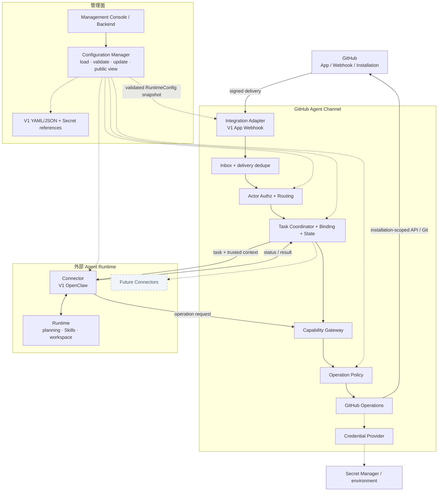

---
title: GitHub Agent Channel 架构与阶段计划
summary: Agent-agnostic 的 GitHub 协作入口；配置边界是 Configuration Manager（V1 用 YAML/JSON+Secret 引用），非独立 Configuration API 基建；经 Connector 接 OpenClaw；控制台不直读文件。
tags:
  - github
  - agent-channel
  - openclaw
  - architecture
created: 2026-11-15
status: ready
---

# GitHub Agent Channel 架构与阶段计划

> 本文收录于 [AI-Engineering-Notes](https://github.com/xallor-ai/AI-Engineering-Notes)，分享 AI 技术研究、工程实践与应用探索。欢迎 Star 关注后续更新，也欢迎通过 Issue 交流和纠错。

配套实操：[[GitHub App 注册指南]]。旧称「OpenClaw GitHub Plugin」已收束为本定位；本文不写运行时代码。

## 产品定位

做的是 **Agent-agnostic 的 GitHub Agent Channel**，不是 OpenClaw 专用 Plugin。

| 部分 | 职责 |
| --- | --- |
| GitHub Channel（执行面） | 承接 GitHub App / Webhook 接入身份、授权上下文与受控操作；负责 @Mention、Inbox/路由、回写、Capability、Policy；只消费 RuntimeConfig |
| Configuration Manager | 加载/校验/更新配置；持久化真源可先为 YAML/JSON；Secret 走引用 |
| Management Console | 如 `OpenClaw-dingtalk-robot`；经后端调 Manager，**不**直读文件、**不**内嵌 Channel 核心 |
| Agent Connector | 连接用户选定的 Runtime（V1：OpenClaw） |
| External Agent Runtime | 推理、规划、Skills、执行语义 |

**Channel 不实现 Agent Runtime。** OpenClaw 是第一个 Connector，不是核心硬依赖。Channel 不是 GitHub 的身份或权限管理替代品，而是把 GitHub 的 Installation 授权、调用者权限和本地操作策略组合成任务范围，并在每次受控操作前核验。工程名倾向 `github-agent-channel`。

**模式 A（V1）**：连接用户已有 Agent。  
**模式 B（非目标）**：托管 Agent Runtime。

## 长期架构图

下图表达长期模块边界；V1 可以在一个进程内按模块实现，不要求每个方框立刻拆成独立服务。



其中，**GitHub 仍是权限事实的权威来源**；Channel 负责验签、解析 Installation、核验调用者和任务范围，并在操作前执行更严格的本地 Policy。Runtime 不应拿到通用 GitHub 写仓凭据；若用户另行配置 PAT 或 SSH 写权限，Runtime 仍可能绕过 Channel，V1 不能宣称对此拥有端到端控制。

## 原则

1. Channel 核心不依赖某一 Runtime 的 SDK / Session / Skill 模型。  
2. GitHub 事件摄入、标准化、路由、回写与 Agent Runtime 解耦。  
3. 多种 GitHub 接入（App、仓库 Webhook）经 Adapter；Webhook ≠ 写仓授权。  
4. Agent 执行与 GitHub 授权分离；外部无权限高危操作直接拒绝。  
5. 新 Runtime 经 Connector 接入，不重写 Channel 核心。  
6. **不为统一而过早造万能 Agent 协议**；先调研能力矩阵再冻结 Connector。  
7. **配置边界是 Configuration Manager，不是配置文件，也不是独立 Configuration API 基建**；执行模块不直接读 YAML；密钥永不回传前端。  
8. V1 核心交互：`@机器人` + 自然语言 → Channel → Connector → Agent →（经 Capability）回写 GitHub。

## 配置：Manager 是边界，YAML 是实现

**合理：现阶段不必专门做独立 Configuration API 层。**

| 概念 | V1 |
| --- | --- |
| 存储 | YAML/JSON 为配置真源 |
| 变更入口 | Configuration Manager（`load` / `validate` / `update` / `getPublicConfig`） |
| 前端 | 经现有管理后端调 Manager；不直读写文件 |
| Secret | 环境变量 / 加密存储 / Secret Manager；配置中只存引用 |
| 执行面 | 只使用校验后的 RuntimeConfig；配置热更新统一刷新 |

注意：Webhook / Connector 等**禁止**到处 `readFile(config.yml)`。无效配置拒绝更新，避免运行时不一致。

渐进：日后 YAML→DB、Manager→独立服务时，执行面与前端契约尽量不变。多实例配置同步**后置**（单机文件先够用）。

可管理对象（不必一次做满 UI）：Connection、Repository Binding、Agent Binding、Execution Policy。Skills 启用以 Runtime/Connector 为主。

## 分层

```text
GitHub (App / Repo Webhook)
  → Integration Adapters
  → Unified Event + Inbox
  → Mention + Caller Authz
  → Agent Conversation Binding
  → Agent Connector (OpenClaw first)
  → External Agent Runtime
  → GitHub Capability (Tools/Ops/Policy/Git) → 回写
```

依赖：Adapter 不直调 Runtime；Runtime 经 Connector；Capability 经 Credential Provider；Policy 不因接入或 Runtime 降级。

## Repo Context vs Agent Session

| 概念 | 职责 |
| --- | --- |
| Repo Context（Channel） | 仓级路由、元数据、与 Binding 关联 |
| Agent Session（Runtime） | OpenClaw Session / Codex Thread / Cursor Conversation 等 |
| Agent Conversation Binding | `connectionId` + provider + instance + `repositoryId` + 外部会话 id/type |

修正：「一仓一 Session」→ **一仓在一个 Binding 下维护主会话关联；是否复用/创建/恢复由 Connector 按 Runtime 能力决定。**  
Session Key / Binding 侧禁止只用 `owner/repo`；须绑定 `connectionId`（及租户隔离字段）。

同仓并发：Channel 侧对同一 Binding 的投递 V1 **串行**。权限**不**从会话历史继承。

## 接入与凭据

| 模式 | 事件 | 写仓凭据 |
| --- | --- | --- |
| GitHub App | App Webhook | Installation Token（推荐） |
| Webhook Only | 仓库 Webhook | 无；非完整写仓 Agent |
| Webhook + PAT | 仓库 Webhook | PAT（轻量；最小 scope；非默认正式） |

V1 先完整实现 **App Adapter**；仓库 Webhook **接口预留、实现可后置**。

## @Mention 与授权

- 默认仅 `@` 触发；忽略自身评论；delivery/comment 去重；编辑默认不重跑。  
- Mention 只识别与鉴权，不选 Skill、不解析任务剧本。  
- Handoff 前校验调用方仓库权限；外部高危 **拒绝**。  
- Policy：create PR 允许 base=默认分支；push/merge 默认分支 **拒绝**；无裸 Shell push 凭据。

## Agent Connector

草拟能力：`connect`、`healthCheck`、`getOrCreateConversation`、`sendMessage`、`getTaskStatus`、`cancelTask`，加 capability flags（streaming / approval / resume / interrupt / workspace）。

V1 只实现 **OpenClaw Connector**。Codex / Cursor / ACP 等先做**能力矩阵调研**（远程提交、续会话、结果流、取消、与 Channel Tools 协作、本地 Agent + 云端 Channel），再决定是否实现。

> [!note] 与 Cursor 内置 GitHub Agent 的关系
> Cursor Agent SDK 已提供 GitHub/Webhook channel。本产品差异化是 **BYO Agent**（用户自选 Runtime），不定位为「取代 Cursor 产品内 GitHub Agent」。

## GitHub Capability 与 Skills

- **Channel 拥有** GitHub 侧任务型能力与 Policy（精选 Tools，非一 API 一 Tool）。  
- Agent 如何调用这些能力由 Connector 适配；V1 经 OpenClaw 注册 Tools。  
- OpenClaw 侧可附带 Skills / `AGENTS.md` 模板（pr-review、pr-development、issue-triage、actions）；**不属于**所有 Runtime 共通核心。

## 社区实现调研：复用基础设施，不照搬产品边界

我对几个代表性实现做了源码级只读调研。调研目录在仓库外的临时目录；未运行项目、未安装依赖、未把第三方代码复制进本仓库。GitHub 直连受限时，部分仓库改用固定提交的 API/raw 源码核对，文章中的链接固定到对应 SHA。

| 项目 | 固定版本与取得方式 | 可借鉴 | 不能直接照搬 |
| --- | --- | --- | --- |
| [`probot/probot`](https://github.com/probot/probot/tree/7682a9ae49fca9ae8b1f7df06f4a201815be1e69) | `7682a9ae`；已 shallow clone；ISC | GitHub App/Webhook 装配、Octokit 上下文、Webhook middleware、throttling/retry 插件 | 默认没有持久 Inbox、delivery 去重、Task/Binding 状态和调用者业务鉴权；不与 Connector/Policy 等价 |
| [`octokit/app.js`](https://github.com/octokit/app.js/tree/523a32f0e9a4c8a8c6e09e24fa92d16ed95eb26b) | `523a32f0`；已 shallow clone；MIT | Installation-scoped client、JWT/Installation Token 缓存与按仓库/权限收窄 | 默认核心不包含完整 retry/throttling；缓存命名空间需隔离 App/Host；SDK 不验证评论者是否有权启动任务 |
| [`OpenHands/automation`](https://github.com/OpenHands/automation/tree/2ebf36191ccc3aefe5c5d84496b9036281d0ba15) | `2ebf3619`；API/raw 复核；MIT | 事件验签、provider event ID 去重入口、组织级 webhook secret、automation run 状态 | 组织管理权限不等于 GitHub 调用者仓库权限；依赖 OpenHands Server/Automation 运行模型，不是 BYO OpenClaw Connector |
| [`sweepai/sweep`](https://github.com/sweepai/sweep/tree/a8b8b67bda4f89faac9314d34e7c7d5a64f76046) | `a8b8b67b`；clone 未形成有效 HEAD，API/raw 复核；EE License | Mention gate、Installation Token 刷新重试、PR/Issue 进度评论与同主题串行队列 | 内存线程状态、PyGithub 强耦合，缺少可靠持久恢复和调用者仓库写权限核验；许可也不适合作为直接复用代码的依据 |
| [`anthropics/claude-code-action`](https://github.com/anthropics/claude-code-action/tree/9fa68854da5fadef4ed3dce240325a0dfe251880) | `9fa68854`；已完整 clone；MIT | Mention 触发解析、actor 权限 gate、评论回写、限定重试和 SDK run 关联 | 本质是 GitHub Actions runner 内的 Agent 执行；将 token 放入 `GITHUB_TOKEN/GH_TOKEN`，不适合直接作为 Channel 的权限 Broker |
| [`github/gh-aw`](https://github.com/github/gh-aw/tree/5ac122295e5e839aa15a727ecf4762f3e680cc24) | `5ac12229`；clone 未完成，官方源码/文档复核；MIT | Actions admission、角色校验、safe outputs 与受信任写入 Job 分离 | 是按次运行的 Actions 编排，不是常驻 Channel/Runtime；safe outputs 可借鉴为 Operation Intent + Trusted Executor 模式 |

可直接形成 V1 选型：GitHub 接入采用轻量 `@octokit/app` + `@octokit/webhooks`，按需加入 retry/throttling；不同时叠加 Probot。原因是 Channel 自己已有 Inbox、Task、Binding、Policy 和 Connector 边界，Probot 的完整应用约定不是第二道安全边界。Webhook 必须执行“验签 → 持久 Inbox/去重 → 快速 2xx → 异步处理”，不能把 SDK 的超时应答当成可靠入库。

社区实现共同暴露了一个关键边界：**Webhook 验签、Installation Token 和 Mention 前缀都不能单独证明调用者有权让 Agent 写仓。** Channel 仍需从可信任务上下文核验 actor、repository、installation、Policy 和操作目标。另一个可复用模式来自 `gh-aw`：Agent 只提出受限的操作意图，由另一个受权限控制的执行面校验并落地；这与本文的 Capability Gateway + Policy + Operations 分层一致。

## 里程碑

| 阶段 | 内容 |
| --- | --- |
| M0 | 本文定位；锁 OpenClaw 版本；Connector 能力矩阵调研提纲 |
| M1 | Channel 核心接口（无 OpenClaw 依赖） |
| M2 | GitHub App Adapter |
| M2.1 | Repository Webhook Adapter（可后置） |
| M3 | OpenClaw Connector + Binding |
| M4 | Capability / Policy / Git |
| M5 | @入口 E2E + 鉴权拒绝（OpenClaw 路径） |

## 对抗结论（摘要）

- Agent-agnostic Channel **比**「OpenClaw Plugin」更清晰，采纳。  
- **Configuration Manager 必要**；独立 Configuration API 基建 **不必**；YAML 只是存储实现。  
- 不为 Channel 单做整套 Console；控制台经后端改配置。  

- V1 **只**落地 OpenClaw Connector；不做托管 Agent、不做万能协议。  
- Skills 降为 OpenClaw 附件；安全仍在 Channel。
