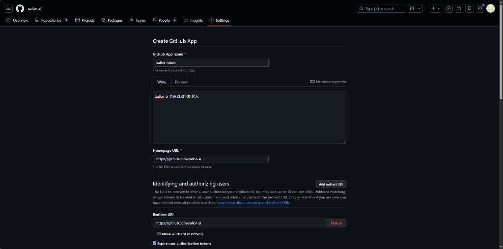
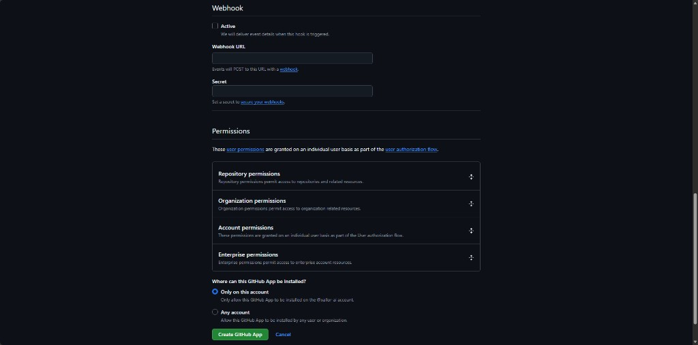
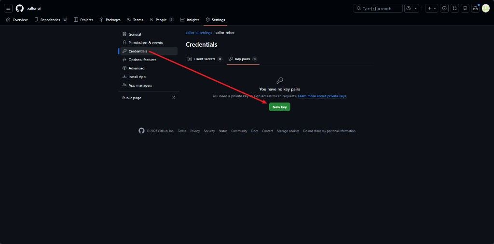

# GitHub App 注册指南

> 本文收录于 [AI-Engineering-Notes](https://github.com/xallor-ai/AI-Engineering-Notes)，分享 AI 技术研究、工程实践与应用探索。欢迎 Star 关注后续更新，也欢迎通过 Issue 交流和纠错。

## GitHub App 是什么

GitHub App 是独立于个人账号的集成身份：在用户或组织账号下**注册**，再**安装**到该账号并授权访问选定仓库。用 App 自己的权限集与 Webhook 收事件，再用安装凭证调 API。

和常见替代比：

| 方式 | 特点 |
| --- | --- |
| Classic PAT | 绑在个人用户上，权限面往往偏大，轮换与审计麻烦 |
| Fine-grained PAT | 也可限仓库与权限，但仍是**个人身份**，随账号走，不适合作为长期机器人身份 |
| OAuth App | 偏「用户登录授权」；仓库自动化也能做，但安装型机器人场景更绕 |
| **GitHub App** | 独立身份、按仓库安装、权限可细到资源类型、事件经 Webhook 推送；限流额度可随安装规模提高 |

本文默认做**安装型**用法：装到仓库后以 Installation 身份读写与收事件，**不**做「安装时请求用户 OAuth 登录」。

## 能做什么、怎么用

典型能力：

1. **收事件**：PR、Issue、评论、Checks / Actions 等变更推到你配置的 Webhook URL。
2. **调 API**：读仓库、评 PR、开 Issue、推分支、触发 Workflow 等（取决于你勾的权限）。
3. **身份隔离**：权限是 App 的上限；Token 还可再收窄；卸装即收回访问。

常见用法：CI 机器人、PR Review / 评论机器人、Issue 分流、把 GitHub 事件接到自建服务。流程：

```text
注册 App → 按需设权限 → 生成私钥 → 安装到仓库
  →（可选）打开 Webhook 并订阅事件 → 自建服务验签并调 API
```

下文按创建页从上到下填写。截图与示例来自 `xallor-robot`（组织 `xallor-ai`），请换成你自己的名称与主页。权限名称以页面 **Repository permissions** 展示名为准。

## 入口

- **组织**（须对该组织有创建 App 的权限，一般为 owner）：Settings → Developer settings → GitHub Apps → **New GitHub App**  
  `https://github.com/organizations/<你的组织>/settings/apps/new`
- **个人账号**：`https://github.com/settings/apps/new`

名称不超过 34 字符；安装后评论里常显示为 `<slug>[bot]`。

## 基本信息



截图里 Redirect URI 填了组织主页，是未清理状态。本文不做用户 OAuth，应 **Delete / 留空**，不要用主页占位。

| 字段 | 建议 | 示例 |
| --- | --- | --- |
| GitHub App name | 全局唯一；与机器人对外名一致即可 | `xallor-robot` |
| Description | 可选简介 | `xallor-ai 仓库自动化机器人` |
| Homepage URL | 无独立产品站时用组织或项目页 | `https://github.com/xallor-ai` |
| Callback / Redirect URI | **不做用户 OAuth 时删除或留空**，不必拿主页占位 | — |
| Setup URL / Redirect on update / Device Flow | 安装型机器人可空、不勾 | — |
| Expire user authorization tokens | 不做用户 OAuth 时可忽略 | — |
| Request user authorization (OAuth) during installation | 不勾选 | — |

## Webhook

向下滚到 Webhook / Permissions（示意见下图）。**创建页上 Active 未勾选时，通常不会出现 Subscribe to events**；事件在勾选 Active 并保存 URL 之后，或创建完成后到 **Permissions & events** 再订。



| 项 | 建议 |
| --- | --- |
| Active | 接收端尚无公网 HTTPS 时可先不勾；就绪后再开 |
| Webhook URL | 创建时可空；须为 HTTPS。本地调试用隧道 |
| Secret | 页面**无**生成按钮；本机造高熵随机串粘贴，与接收端同一串做 HMAC（`X-Hub-Signature-256`） |

```bash
openssl rand -hex 32
```

PowerShell（密码学随机，勿用 `Get-Random`）：

```powershell
$bytes = [byte[]]::new(32)
[System.Security.Cryptography.RandomNumberGenerator]::Create().GetBytes($bytes)
[BitConverter]::ToString($bytes).Replace('-', '').ToLower()
```

Secret 与接收服务各留一份用于验签，勿进 Git。就绪后到 App 的 **General**：勾选 Active → 填 URL → 建议保持 **Enable SSL verification** → **Save changes**。

## Repository permissions

**最小权限**：只开会用到的资源。Metadata 为 Read-only（常已锁定）。Organization / Account / Enterprise 与未用到的 Repository 项保持 **No access**（含 Administration、Secrets、仓库级 Webhooks、Codespaces 等，除非你明确要管）。

能订阅哪些 Webhook 事件，取决于已开的权限（无 Pull requests 权限就订不了 PR 类事件）。页面下拉多为 `No access` / `Read-only` / `Read and write`。改 `.github/workflows` 需要 Workflows 的 Read and write，通常还要 Contents 写。

App **已安装后再加权限**，还须由安装账号批准权限更新，未批准前仍是旧权限集。

### 按场景勾选

| 场景 | 权限 |
| --- | --- |
| 读仓库基础信息 | Metadata Read |
| 订阅某类事件（只收、不写） | 该类资源至少 Read（如 PR 事件要 Pull requests Read） |
| Issue / PR **时间线**评论 | Issues **或** Pull requests 其一为 Read and write 即可 |
| PR **行内**评论 | Pull requests Read and write，并订 `Pull request review comment` |
| 读 CI 并评论 | 评论所需权限 + Checks Read（或 Actions Read） |
| 推非默认分支 / 改文件 | Contents Read and write；仓库应对默认分支开保护（禁直推、需 PR，本 App 不进 bypass） |
| 触发工作流运行 | Actions Read and write |
| 改 workflow 文件 | Workflows Read and write + Contents 写 |

不要把多场景权限并成一份「推荐全开」清单；最终取你真实会用到的并集。

## 订阅事件

在 **Permissions & events** 勾选。先设权限，再订事件。

| 事件 | 常见用途 | 通常还要 |
| --- | --- | --- |
| Issue comment | Issue / PR 时间线评论 | Issues 或 Pull requests |
| Pull request review comment | 行内评论 | Pull requests |
| Pull request | PR 开/改/关 | Pull requests |
| Issues | 开/关 Issue、改标签 | Issues |
| Check run / suite、Workflow run | CI | Checks 或 Actions |

无公网接收端可先不 Active；有 URL 后再开 Active 并保存事件。

## 安装范围

| 选项 | 何时选 |
| --- | --- |
| **Only on this account** | 只装在创建它的用户或组织上（内部 App） |
| **Any account** | 要让其他用户或组织安装、或上 Marketplace |

私有内部机器人选前者即可。点绿色 **Create GitHub App**。

## 创建后：凭证与安装

**标识符**（可记在配置里，但不能当认证）：App ID、Client ID（General）、Installation ID（安装页 URL、`GET /app/installations`，或 Webhook payload）。

**密钥**（本机密码库 / 环境变量；勿进 Git、勿写进公开笔记；接收服务要持有 Webhook secret 才能验签）：

1. **Private key**（`.pem`，见下）
2. **Webhook secret**（与创建时同一串）

`.pem` 不是 API Token，也不是 Client secret。服务端用私钥签发短时 JWT（`iss` 填 App ID 或 Client ID，文档更推荐后者），再换成大约一小时有效的 Installation Access Token。Client secret 只用于用户 OAuth，纯安装型一般不需要。

### 生成 Private key

App 设置 → **Credentials** → **Key pairs** → **New key**



浏览器下载 `.pem`。私钥只在此刻可下；丢失需再 New key。

### 安装到仓库

**Install App** → 选择组织/账号 → 勾选仓库 → Install。从安装成功页 URL 可抄 Installation ID。

参考：[Choosing permissions](https://docs.github.com/en/apps/creating-github-apps/registering-a-github-app/choosing-permissions-for-a-github-app) · [Authenticating as a GitHub App](https://docs.github.com/en/apps/creating-github-apps/authenticating-with-a-github-app/about-authentication-with-a-github-app) · [Webhook events](https://docs.github.com/en/webhooks/webhook-events-and-payloads)
