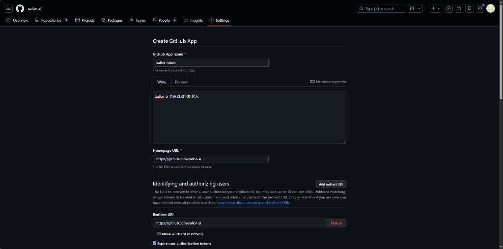
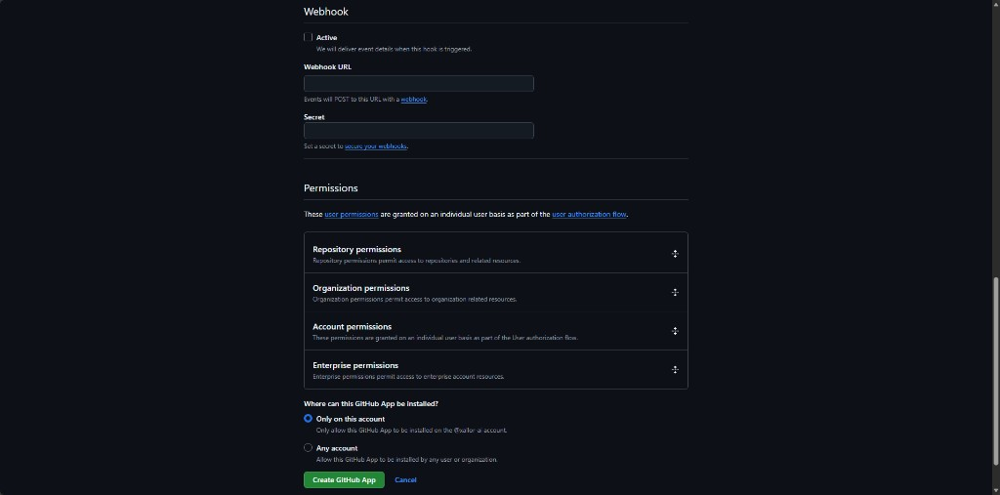

# GitHub App 注册指南：xallor-robot

> 本文收录于 [AI-Engineering-Notes](https://github.com/xallor-ai/AI-Engineering-Notes)，分享 AI 技术研究、工程实践与应用探索。欢迎 Star 关注后续更新，也欢迎通过 Issue 交流和纠错。

本文记录在 GitHub 组织 `xallor-ai` 下注册安装型 App `xallor-robot` 的实操填写。目标形态是：GitHub 负责身份与事件投递；接收与读写由后续 OpenClaw Plugin 完成。

## 先分清两层

| 层 | 在哪做 | 性质 |
| --- | --- | --- |
| GitHub App | GitHub Developer Settings | 配置：工牌、权限、Webhook 地址 |
| 接收端 | 本机 / OpenClaw Plugin | 开发：验签、换 Token、调 API、唤醒 Agent |

在 GitHub 网页上「Create GitHub App」只完成上一层。

## 入口

组织设置 → Developer settings → GitHub Apps → **New GitHub App**  
（或：`https://github.com/organizations/xallor-ai/settings/apps/new`）

## 基本信息怎么填

参考已填写示意：



| 字段 | 建议值 | 说明 |
| --- | --- | --- |
| GitHub App name | `xallor-robot` | 全局唯一；显示名可与此相同 |
| Description | `xallor-ai 仓库自动化机器人` | 可选；给安装者看的简介 |
| Homepage URL | `https://github.com/xallor-ai` | 必填；无独立产品站时用组织页即可 |
| Redirect URI | `https://github.com/xallor-ai` | 第一期不做「用户 OAuth 登录」时作占位 |
| Allow wildcard matching | 不勾选 | — |
| Expire user authorization tokens | 勾选 | 默认即可 |

第一期使用 **Installation（装到仓库）** 身份，不是用户 OAuth。若页面出现 **Request user authorization (OAuth) during installation**，不要勾选。

## Webhook / 权限 / 安装范围（本页后半段）

向下滚动到与下图一致的区域后再填：



图中现状通常是：

- **Active** 未勾选  
- **Webhook URL / Secret** 为空  
- **Permissions** 四个分组折叠未展开  
- 安装范围已选 **Only on this account**（正确，保持）

按下面三节逐项配置，再点绿色 **Create GitHub App**。

### Webhook

| 项 | 第一期建议 | 说明 |
| --- | --- | --- |
| Active | **先不勾选**（与截图一致） | 未勾选时 GitHub 不会投递事件；等 Plugin 有公网 HTTPS 入口后再勾选 |
| Webhook URL | 创建时可留空 | 就绪后填 Plugin 的 HTTPS 路径（如 Gateway `registerHttpRoute`）；本地调试可用 smee.io / ngrok 等隧道转发到本机 |
| Secret | **自备一串高熵随机口令，粘贴进输入框** | 页面上**没有**「生成」按钮。它是你与 GitHub 约定的共享口令，用来验 HMAC；与在哪台机器生成无关 |

> [!note] Secret 是什么、为什么「随便造一串」
> **不是**绑定某台机器、某次安装或某个仓库的硬件指纹。它只是一段双方都知道的口令：
>
> 1. 你填进 GitHub App 的 **Secret**  
> 2. 同一串再放进接收端（OpenClaw Plugin / 环境变量）  
> 3. GitHub 每次投递带签名；接收端用这串验签，证明请求来自 GitHub、内容未被改
>
> 因此：**在哪台电脑执行生成命令都行**（笔记本、跳板机、WSL 均可），输出拷走即可；命令本身不依赖特定环境。所谓「随便」是指**内容不必有业务含义**，不是可以随便用短密码或公开示例串——要用足够长、不可猜测的随机串。
>
> GitHub 创建页不会帮你点一下出串。任选一台可信机器跑：
>
> ```bash
> openssl rand -hex 32
> ```
>
> Windows PowerShell：
>
> ```powershell
> -join ((1..64) | ForEach-Object { '{0:x}' -f (Get-Random -Max 16) })
> ```
>
> 把输出整段粘贴进 **Secret**，并另存到密码库 / 接收端环境变量（勿提交 Git、勿贴进公开 Issue）。

> [!tip] 为什么先关 Active、但仍可填 Secret
> Secret 与 URL 可分开准备：没有接收端时不要开 Active，避免投递失败堆积。创建时也可先留空 Secret，等有接收端再一起填——但一旦开始收事件，**GitHub 上的 Secret 与验签端必须是同一串**。

接收端就绪后的改法：App 设置页 → 勾选 Active → 填入最终 Webhook URL（及 Secret，若创建时未填）→ Save。

### 仓库权限（展开 Repository permissions）

点开 **Repository permissions**，只改下列项；其余保持 **No access**。Organization / Account / Enterprise 三组第一期全部不配。

| Permission | 级别 | 用途 |
| --- | --- | --- |
| Metadata | Read-only | 必选底座；装 App 后自动具备 |
| Contents | Read-only | 读仓库文件 / 树；暂不写代码 |
| Issues | Read & write | 读 Issue、评论、关单等 |
| Pull requests | Read & write | 读 PR、评论、改状态等 |
| Checks | Read-only（可选） | 若机器人要读 CI 结论再开 |

> [!warning] 最小够用
> 不要一次打开 Administration、Secrets、Workflows 等高危权限。需要 Checkout / Push 时再单独把 Contents 升到 Read & write，并记入变更原因。

### 订阅事件（Subscribe to events）

权限保存后，页面会出现 **Subscribe to events**（或创建后在 App 设置里改）。第一期只勾：

- `Pull request`
- `Issue comment`

按需再开：

| 事件 | 何时再开 |
| --- | --- |
| `Issues` | 要监听开/关 Issue、改标签等，而不只是评论 |
| `Pull request review` / `Pull request review comment` | 要处理行内 Review 评论 |

Webhook 未 Active 时，勾选事件只是「就绪清单」：真正投递要等 Active + 有效 URL。

### 安装范围（Where can this GitHub App be installed?）

| 选项 | 第一期 |
| --- | --- |
| **Only on this account** | **选这个**（仅 `@xallor-ai`） |
| Any account | 不要选；公开可装会扩大攻击面与支持面 |

与截图一致即可，创建后一般也不改成 Any account。

## 创建后立刻保存的材料

1. **App ID**（设置页可见）  
2. **Private key**（Generate a private key，下载 `.pem`，勿提交到 Git）  
3. **Webhook secret**（与创建时一致）  
4. 安装到目标仓库后的 **Installation ID**（安装页 URL 或 API 可查；Webhook Payload 里也会带）

密钥只放本机密钥库 / 环境变量 / OpenClaw SecretRef，不要写进笔记正文或仓库。

## 安装到仓库

App 设置 → **Install App** → 选择 `xallor-ai` → 勾选需要的仓库（例如 `AI-Engineering-Notes`）→ Install。

## 与后续 OpenClaw 的关系

```text
GitHub App（本文）
  → Webhook
  → OpenClaw Plugin（验签 / Token / Tools）
  → OpenClaw Agent（现有模型与 Skills）
```

本文只覆盖 App 注册与安装配置；Plugin 开发另文记录。

## 检查清单

- [ ] 基本信息与示意一致（名称、主页、Redirect 占位）  
- [ ] 未开启「安装时请求用户 OAuth」  
- [ ] Webhook：创建时 Active 关闭；Secret 已用本机命令生成并粘贴（页面无生成按钮），或创建后补填  

- [ ] Repository permissions：Metadata / Contents / Issues / Pull requests（及可选 Checks）按上表  
- [ ] Organization / Account / Enterprise 权限未乱开  
- [ ] 事件：至少 `Pull request` + `Issue comment`  
- [ ] 安装范围：Only on this account  
- [ ] 创建后保存 App ID、私钥 `.pem`、Webhook secret  
- [ ] Install App 到目标仓库，记下 Installation ID  
- [ ] Plugin 就绪后再打开 Active 并写入真实 Webhook URL  
