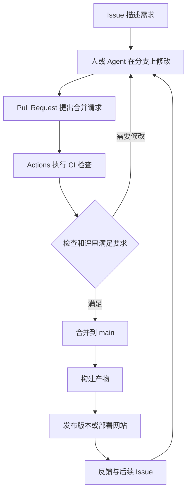

# GitHub 协作与自动化：01 学习路线

> 本文收录于 [AI-Engineering-Notes](https://github.com/xallor-ai/AI-Engineering-Notes)，分享 AI 技术研究、工程实践与应用探索。欢迎 Star 关注后续更新，也欢迎通过 Issue 交流和纠错。

目标：看懂 GitHub 仓库的主要入口，能完成从提出需求、修改代码、自动检查到发布的流程，并能使用仓库的 Agents 页面委派任务。

这套笔记围绕一个练习仓库 `github-workflow-lab` 展开。前半部分使用网页即可开始；CI 示例用很小的 Python 程序，不要求先学习 Web 框架。所有示例文件都应放在练习仓库，本文所在的笔记库只保存教程。

资料核对日期：2026-11-16。Agents、套餐和组织策略变化较快，实际可用入口以登录后的账户及文中官方链接为准。

## 1. 先认识一次改动经过哪些地方

这是本教程采用的流程设计，实际团队可以调整。提交代码后发生什么，取决于仓库的事件配置、合并规则和部署流程。

## 2. 仓库页面导航

| 页面或入口 | 你来这里做什么 | 本教程中的用途 |
|---|---|---|
| Code | 浏览文件、切换分支、查看提交 | 确认代码和 workflow 配置 |
| Issues | 描述问题、需求及验收条件 | 提出一个小改动 |
| Pull requests | 比较改动、讨论、检查、评审和合并 | 查看 CI 和最终变更 |
| Actions | 查看自动化运行、任务日志和产物 | 找到失败步骤并修复 |
| Agents | 发起、跟踪和管理 Agent 会话 | 委派任务并追踪结果 |
| Releases | 发布版本说明和下载附件，通常从 Code 页侧栏进入 | 给版本命名并说明变化 |
| Settings | 管理 Actions、Pages、权限及规则 | 使检查成为合并条件、启用部署 |
| Projects | 组织工作项和进度 | 项目较大时再使用 |
| Discussions / Wiki | 讨论和知识整理 | 根据团队习惯选用 |

Agents 的产品含义是 Agent 会话管理入口；官方说明可见 [Agent management](https://docs.github.com/en/copilot/concepts/agent-capabilities/choosing-and-delegating-agent-work/agent-management)。

## 3. 按成果学习

| 章节 | 文档 | 做完后应拿到的结果 |
|---|---|---|
| 02 | [[GitHub 协作与自动化：02 Issue、分支与 Pull Request]] | 一个合并的 PR，以及关联的 Issue |
| 03 | [[GitHub 协作与自动化：03 Actions 与 Workflow]] | 一次手动执行成功的 workflow，能找到 step 日志 |
| 04 | [[GitHub 协作与自动化：04 CI 与合并检查]] | 同一个 PR 从失败变为通过，知道如何阻止带错误的合并 |
| 05 | [[GitHub 协作与自动化：05 构建、发布与部署]] | 一个由主分支构建并部署的网站，以及版本记录 |
| 06 | [[GitHub 协作与自动化：06 Agents 与任务委派]] | 一次有明确验收条件的 Agent 任务及可评审结果 |
| 07 | [[GitHub 协作与自动化：07 gh-aw 与智能自动化]] | 理解 Markdown 如何变成 Actions 自动化，完成可选练习 |
| 08 | [[GitHub 协作与自动化：08 GitHub App 注册与权限配置]] | 注册自己的 App，配置权限、事件和仓库安装范围 |
| 09 | [[GitHub 协作与自动化：09 Cursor GitHub Agent 接入]] | 使用现成 GitHub App，完成 Cursor 的仓库连接和 Agent 自动化实践 |

本篇为第 01 篇。可以先通读第 06 篇了解 Agents 页面，再按第 02～05 篇动手。第 07 篇建立在 Actions 基础上。

第 08 篇为自建 GitHub App 的接入实践；第 09 篇以 Cursor 为例，讲现成 App 的安装和使用。两篇都不依赖第 07 篇。所有文章平铺在笔记目录，通过本页和相邻章节链接组成系列。

## 4. 术语速查

| 术语 | 本教程中的含义 |
|---|---|
| GitHub flow | 围绕分支和 PR 的协作方式 |
| Workflow | 广义是工作流程；在 Actions 中是可执行的自动化定义 |
| Pipeline | 带依赖关系的一组自动化任务的通称，可以由一个或多个 workflow 实现 |
| CI | 持续集成：频繁整合改动，自动检查是否破坏已有行为 |
| CD | 持续交付或持续部署；前者可保留人工发布决定，后者自动进入生产 |
| GitHub Actions | 运行自动化的平台 |
| action | workflow 中可复用的操作组件 |
| workflow run | 某个 workflow 的一次具体执行 |
| job / step / runner | 任务 / 步骤 / 执行任务的机器或环境 |
| Agent session | 一次 Agent 工作会话，包含任务、交互和执行记录 |
| GitHub App | 通过安装与权限授权扩展 GitHub 能力的应用，可用于接入第三方服务 |
| Artifact | 自动化输出并保存的文件，例如构建包、报告 |
| Release / Deployment | 发布版本记录 / 将产物放入运行环境 |

Actions 层次参见 [Understanding GitHub Actions](https://docs.github.com/en/actions/get-started/understand-github-actions)。

## 5. 完成标准

- [ ] 能指出一个 PR 的来源分支和目标分支。
- [ ] 能说明为什么某次提交触发或没有触发 workflow。
- [ ] 能从红色检查进入失败 step，读到具体错误。
- [ ] 能区分“测试通过”“允许合并”“已部署”。
- [ ] 能说明发布的网站对应哪个提交。
- [ ] 能从 Agent session 找到改动，核查测试，再决定是否合并。
- [ ] 能区分 Agents 页面、Actions 页面和 `gh-aw` 项目。
- [ ] 能说明 GitHub App 的安装、仓库授权与第三方功能开关分别控制什么。
- [ ] 能区分自建 GitHub App 与现成服务 App 的接入方式。

## 6. 本套材料的验证范围

教程中的 Python 示例可在本地验证；GitHub 的远端触发、账户权限、Pages 发布和 Agent 会话需要在练习仓库实际执行。阅读或复制 YAML 不等于已完成云端验证。每篇的“验收”用于记录你实际看到的结果。
