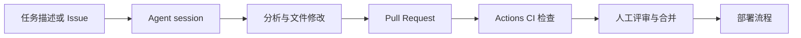

# GitHub 协作与自动化：06 Agents 与任务委派

> 本文收录于 [AI-Engineering-Notes](https://github.com/xallor-ai/AI-Engineering-Notes)，分享 AI 技术研究、工程实践与应用探索。欢迎 Star 关注后续更新，也欢迎通过 Issue 交流和纠错。

学习路线：[[GitHub 协作与自动化：01 学习路线]]。

> 本篇选择当前操作仓库的 `master` 为基础，由 Agent 创建自己的工作分支和面向 master 的 PR，无需预建固定分支。

## 1. 先读懂 Sessions 页面

以 `github/gh-aw` 仓库的 Agents → Sessions 页面为例：如果选择 Completed，并输入 `is:closed author:@me`，可以这样理解页面内容。

| 页面内容 | 怎么理解 |
|---|---|
| Agents 标签 | 仓库的 Agent 会话入口 |
| Actions 标签 | 仓库自动化流程的运行入口 |
| Sessions | 一次次 Agent 工作记录 |
| Active / Completed | 按会话状态切换查看范围 |
| `is:closed author:@me` | 当前只查符合关闭状态、作者为自己的记录 |
| Author / Status / Type / Agent | 进一步筛选会话 |
| No sessions match your filters | 当前筛选没有匹配结果 |

从这个空列表只能判断“没有匹配当前筛选的会话”，不能判断仓库完全没用过 Agent，也不能判断你的账户是否有启动权限。先清除筛选、切换状态，再检查账户和仓库权限。

`github/gh-aw` 是这个例子中的仓库名。Agents 是 GitHub 的产品入口，不是该仓库额外实现的页面。不要直接在这个上游仓库做写入练习；用第 01 篇定义的目标仓库。

## 2. Session、PR、Actions run 如何对应

一个 session 是 Agent 的工作上下文。它可能只是调查问题，也可能修改代码并创建 PR。PR 用于讨论、检查和合并变更；Actions run 是一套自动化配置的一次执行。



这是本教程练习链路，不是所有会话的固定生命周期。当前官方入口区分 Cloud sandbox 和 Actions 等执行环境，所以“每个 session 都等于一个普通 workflow run”不成立。[启动任务说明](https://docs.github.com/en/copilot/how-tos/copilot-on-github/use-copilot-agents/kick-off-a-task)

## 3. 启动前检查三件事

首先确认你能访问并修改练习仓库；其次确认账号具有所选 Agent 的使用资格；最后确认组织没有禁用该能力。能看到别人的公开仓库，不等于能在那个仓库委派 Agent 改代码。

会话产生的 AI 使用及执行资源按所选产品和账户计量。实际使用前看账户的使用量和预算页面；本教程不固定价格或套餐名称，避免操作时已经变化。入口缺失时优先核对 [官方可用条件](https://docs.github.com/en/copilot/how-tos/copilot-on-github/use-copilot-agents/kick-off-a-task)，不要反复改仓库文件猜原因。

## 4. 第一个任务：给现有函数加输入检查

先完成 [[GitHub 协作与自动化：04 CI 与合并检查]]。在自己练习仓库的 Agents 页面或 GitHub Copilot 会话入口选择该仓库，使用可用的 Agent 和执行环境，明确以 `master` 为基础发起任务。

复制以下任务描述：

```text
请修改 app.py 中的 greeting，并创建一个面向 `master` 的 Pull Request。

需求：
1. name 不是字符串时，抛出 TypeError，消息为 name must be a string。
2. 保持正常名字、首尾空格处理和空白名字拒绝行为不变。
3. 在 test_app.py 中覆盖 None、整数，以及现有三种行为。

验证：运行 python -m unittest discover -v 和 python build.py。
范围：只修改实现和相关测试，不修改 GitHub workflow，不合并 PR。
结果说明：列出修改文件、执行命令、测试结果；没有执行的检查明确说明。
```

这个任务可以从三处观察结果：实现是否拒绝非字符串输入，测试是否覆盖新增情况，以及是否创建了 PR。提示中写明“创建 PR”，是因为从 prompt 发起的会话不必自动创建 PR。

另一种入口是先新建包含同样内容的 Issue，再通过 Assignees 指派 Copilot。官方将 Issue 指派描述为创建 PR 的入口；不同 Agent App 的行为以自己的文档为准。[启动任务的两种入口](https://docs.github.com/en/copilot/how-tos/copilot-on-github/use-copilot-agents/kick-off-a-task)

## 5. 过程中怎么看、怎么纠偏

进入 session，查看进度、操作日志和修改。如果 Agent 改了无关文件，在可用的会话输入框中补充约束，例如“保留当前函数签名，只补输入类型检查”。

对 Issue 指派的任务，后续新增的 Issue 评论不应假定会自动进入既有任务；使用会话的 steering 入口或关联 PR 的受支持交互方式补充要求。

完成时核对：它是否真的执行了测试命令、是否报告失败、是否给出了修改或 PR。Completed 表示会话完成，不意味着功能已验收或代码已合并。[会话管理说明](https://docs.github.com/en/copilot/how-tos/copilot-on-github/use-copilot-agents/manage-and-track-agents)

## 6. 从完成会话到可合并 PR

1. 打开关联 PR；若还没有，按会话入口创建或要求 Agent 创建。
2. 在 Files changed 中确认只修改 `app.py`、`test_app.py`。
3. 查看是否覆盖 None、整数和原有三种情况。
4. 查看当前提交的 **Test and build** CI 结果；若页面要求批准 workflow 运行，阅读改动后按仓库流程处理。
5. 需要修改时在支持的交互入口提出具体要求，等待更新后再次核查。
6. 只有满足原有检查及评审要求后再合并。后续 Pages 部署按已有 `master` push 配置发生。

“Agent 自测”提供一次执行记录；“PR CI”提供仓库约定的统一检查；“评审”判断需求与改动是否匹配。三者各有用途。

## 7. Custom agent、AGENTS.md 和 gh-aw

| 名称 | 用途 | 会不会自己启动任务 |
|---|---|---|
| Agents 页面 | 发起、查看和管理会话 | 用户从入口启动，或配置自动化触发 |
| Custom agent | 定义某类任务的角色、提示和工具范围 | 定义本身不是定时任务 |
| `AGENTS.md` | 支持它的工具读取的仓库工作约定 | 单独放置不会自动启动云端任务 |
| `gh-aw` | 定义并编译由 Agent 执行的仓库自动化 | 生成的 workflow 按配置事件触发 |

GitHub 自定义 Agent 的仓库配置常见于 `.github/agents/*.agent.md`，先跑通默认 Agent 再做专门角色。[自定义 Agent 官方说明](https://docs.github.com/en/copilot/how-tos/copilot-on-github/customize-copilot/customize-cloud-agent/create-custom-agents)

[[GitHub 协作与自动化：08 GitHub App 注册与权限配置]] 讲解如何注册自己的 GitHub App、配置权限并安装到仓库；[[GitHub 协作与自动化：09 Cursor GitHub Agent 接入]] 则讲安装现成的 Cursor App。App 提供集成身份和授权；是否具有 Agent 能力、是否出现在 Sessions 中，取决于具体实现。

## 8. 常见问题与结果检查

| 现象 | 先检查 |
|---|---|
| Sessions 空白 | 清除作者、状态等筛选，确认所在仓库 |
| 有页面但不能发任务 | 写权限、Agent 资格、组织策略、可用入口 |
| 会话完成却没有 PR | 任务是否仅要求分析；是否明确要求创建 PR |
| 已修改但测试没跑 | 会话环境、安装步骤、工具日志及错误 |
| PR 没有 CI 结果 | workflow 事件和分支条件，是否等待授权运行 |
| 提示额度不足 | Agent 使用量、执行资源及账户预算，不只看 GitHub 登录状态 |

一次任务可以产生会话记录、代码修改、测试输出和 PR。Session 显示完成但没有 PR 时，先核对任务是否要求创建 PR；PR 已创建但检查未通过时，继续修复并等待新提交的检查结果，不能仅凭会话状态决定合并。

下一篇：[[GitHub 协作与自动化：07 gh-aw 与智能自动化]]。
