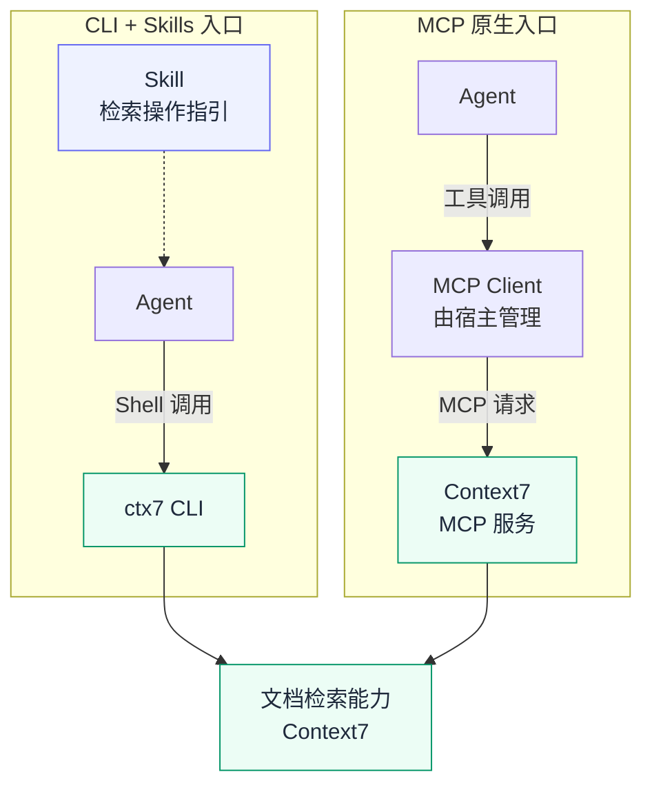
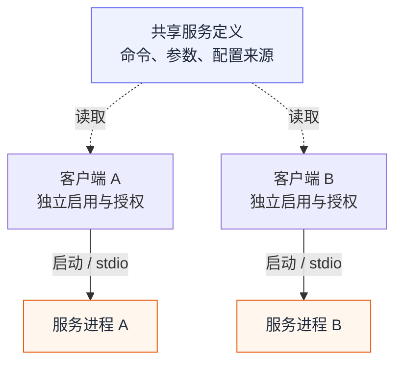

# Skill + CLI vs MCP：为什么 Agent 工具还不能一次配置，到处使用？

> 本文收录于 [AI-Engineering-Notes](https://github.com/xallor-ai/AI-Engineering-Notes)，分享 AI 技术研究、工程实践与应用探索。欢迎 Star 关注后续更新，也欢迎通过 Issue 交流和纠错。

手动配置同一个 MCP 服务，在 Cursor 里要写进 `mcp.json`，换到 Codex，又要改成 `config.toml` 中的 TOML 配置。服务没变，启动命令或地址也没变，用户却要重新寻找配置入口、转换字段和格式。既然 MCP 已经统一了工具通信，为什么配置还不能跨客户端复用？

再看另一条路：如果工具已经提供命令行接口，能不能配上一份 Skill，让不同 Agent 直接使用？

这两个问题看起来是在比较技术路线，实际涉及三件不同的事：工具如何调用、能力如何被发现，以及配置如何在客户端之间复用。

MCP 让不同客户端能够按照共同协议调用工具。Agent Skills 让操作知识能够以文件形式分发。CLI 则提供了大量开发工具已经采用的命令入口。三者各有价值，但它们解决的问题并不重合。

本文以公开产品和文档为依据，讨论本地编程 Agent 的使用体验。资料核对日期为 **2026 年 11 月 11 日**；目录兼容性来自官方文档或官方仓库说明，未对所有客户端逐一完成运行验证。云端、容器和远程执行环境需要单独判断。

## 1. 用同一个公开产品比较两种入口

[Context7](https://github.com/upstash/context7) 是 Upstash 开发的文档检索工具，帮助 Agent 查找软件库的最新文档和代码示例。它同时提供 **CLI + Skills** 和 **MCP** 两种接入方式，适合用来比较同一产品在不同入口下的使用体验。

通过 `npx ctx7 setup`，用户可以选择接入模式，并完成认证和安装配置。

两种模式服务于相同的文档检索目的，但不意味着命令参数、工具 Schema 和输出格式完全一致。官方 CLI 文档分别列出了 `ctx7 library`、`ctx7 docs` 等命令，以及 MCP 的 `resolve-library-id`、`query-docs` 工具。[Context7 CLI 文档](https://context7.com/docs/clients/cli)



*图 1：Context7 的两条接入路径。虚线表示操作指引，实线表示调用方向，结果沿调用链返回。*

其中，Skill 负责说明什么时候用、怎样用、如何处理失败；CLI 负责执行。MCP 提供结构化的工具通信接口，操作流程也可以由 Skill 补充。

因此，比较应当聚焦于：**为了让同一项能力在多个 Agent 中可用，用户和工具开发者分别需要承担多少工作？**

## 2. Skill、CLI 和 MCP 各自负责什么

| 组成 | 主要职责 | 本身不保证什么 |
| --- | --- | --- |
| Skill | 描述适用场景、工作流、参考资料和执行方式 | 不保证客户端有对应命令、权限或运行环境 |
| CLI | 接收参数、执行操作、输出结果 | 不保证 Agent 会发现它，或能正确理解参数与输出 |
| MCP | 为客户端和服务提供共同的工具通信契约 | 不保证所有客户端共读同一份本机配置 |

对具备 Shell 能力的本地编程 Agent，Skill + CLI 的吸引力很直接：命令安装在共同可访问的环境中，业务配置保存在用户目录，多个 Agent 就有机会复用它们，而不必分别登记一个 MCP 服务。

但这里存在前提：客户端需要发现 Skill，执行环境需要找到命令，账号与权限需要有效。CLI 最好提供稳定的 JSON 输出、明确的退出码、超时控制和非交互模式，否则只是把配置成本换成了命令解析与错误处理成本。

可以用四个维度判断一项能力是否真正可复用：

| 复用维度 | 核心问题 | 常见承载方式 |
| --- | --- | --- |
| 能力描述 | Agent 能否发现并理解使用方法？ | Skill、工具说明、使用指南 |
| 调用接口 | 能否按约定传参并处理结果？ | CLI、MCP 工具接口 |
| 执行环境 | 命令、依赖、网络和文件系统是否可用？ | 本机、容器、远程执行环境 |
| 配置与身份 | 服务地址、凭据和授权是否适用于这次执行？ | 用户配置、凭据存储、客户端授权 |

共享 Skill 主要解决能力描述的复用，其余三项仍需由工具和执行环境配合完成。有状态任务还需要处理跨调用的生命周期。

MCP 在需要客户端原生工具管理，或客户端不提供本地 Shell 的场景中仍然有价值。远程服务也可以通过 CLI 调用，不能仅按本地或远程划分路线。一个工具完全可以共享业务核心，同时提供 CLI 与 MCP 两种入口。

## 3. `~/.agents/skills` 正在成为通用目录约定

Skill 跨客户端复用的一个实际进展，是多个产品开始支持同一个用户级目录：

```text
~/.agents/skills/<skill-name>/SKILL.md
```

这里应区分两层：

- **文件格式兼容**：客户端理解 Agent Skills 的 `SKILL.md` 结构。
- **目录发现兼容**：客户端会主动扫描这个位置，把 Skill 提供给 Agent。

支持相同格式，不等于扫描相同目录；能够扫描目录，也不等于支持所有客户端特有字段或执行机制。

截至本次核对，各产品官方文档列出的 **本地 Skill 目录发现能力** 如下：

| 产品 | 对 `~/.agents/skills` 的支持 | 条件或边界 |
| --- | --- | --- |
| Codex | 官方明确支持用户级发现 | Skill 可被禁用；大目录下初始展示还受上下文预算影响 |
| Cursor | 官方明确支持本地用户级发现 | 不会因此自动同步到 Cloud Agent 或远程 SSH 环境 |
| Pi | 官方明确支持 | 支持按需读取；目录变化后的刷新遵循其加载规则 |
| OpenCode | 官方列为全局兼容目录 | 仍有自身的来源优先级和权限规则 |
| OpenClaw | 官方支持 Personal Agent Skills | 使用非默认状态目录时，会排除该用户级兼容来源 |
| DeepSeek Harness | 官方文件系统 Skill Provider 支持 | 依赖 Provider 加载与默认根目录配置；`agentsHome` 可被覆盖 |
| Claude Code | 官方个人目录为 `~/.claude/skills` | 未列出原生扫描 `.agents`；可用逐 Skill 符号链接适配 |

依据：[Codex](https://learn.chatgpt.com/docs/build-skills)、[Cursor](https://cursor.com/docs/skills)、[Pi](https://pi.dev/docs/latest/skills)、[OpenCode](https://opencode.ai/docs/skills/)、[OpenClaw](https://docs.openclaw.ai/tools/skills)、[DSH 官方 Provider](https://github.com/deepseek-ai/deepseek-harness/blob/master/packages/skill/skill-filesystem/README.md)、[Claude Code](https://code.claude.com/docs/en/skills)。

这些产品的采用，使 `~/.agents/skills` 成为统一分发时值得优先考虑的位置。**它正在成为跨客户端的通用目录约定，但尚未覆盖所有产品。** Agent Skills 的文件格式规范与客户端的目录发现规则仍是两件事。[Agent Skills 规范](https://agentskills.io/specification)

对于 Claude Code，可以保留原有目录，只给需要共享的 Skill 建立链接：

```text
~/.agents/skills/example-skill/       ← 内容存放位置
    └── SKILL.md

~/.claude/skills/example-skill       → 指向上述目录
```

Claude Code 官方明确支持个人、项目等 Skill 目录中的符号链接。逐 Skill 建链接也比替换整个目录更容易处理同名项及账号同步内容；实际安装仍需处理操作系统权限和已有目录冲突。[Claude Code 目录规则](https://code.claude.com/docs/en/skills)

跨客户端分发还应优先采用单层 Skill 布局。比如 DSH 官方 Provider 发现的是直接子目录中的 `<name>/SKILL.md`，并不递归发现任意深度的 `SKILL.md`。因此，`skills/category/example/SKILL.md` 不能因为在某个客户端可用，就视为通用布局。[DSH 格式与发现规则](https://github.com/deepseek-ai/deepseek-harness/blob/master/packages/skill/skill-filesystem/README.md)

## 4. MCP 的差异，甚至从 JSON 和 TOML 开始

这里比较的是 **MCP 宿主产品的配置方式**。Codex、Cursor 等应用在内部使用 MCP Client 连接服务；它们如何保存服务定义，与通信协议本身是两个问题。

回到 Context7。向两个客户端配置同一个远程 MCP 地址，配置文件的路径、语法和字段结构就已经不同。

Cursor 的用户级文件是 `~/.cursor/mcp.json`，使用 JSON 的 `mcpServers` 对象：[Cursor MCP 文档](https://cursor.com/docs/mcp)

```json
{
  "mcpServers": {
    "context7": {
      "url": "https://mcp.context7.com/mcp"
    }
  }
}
```

**Codex 的 MCP 配置不是 JSON，而是 TOML。** 默认用户级文件是 `~/.codex/config.toml`，服务定义放在 `mcp_servers` 表中：[Codex MCP 文档](https://learn.chatgpt.com/docs/extend/mcp?surface=cli)

```toml
[mcp_servers.context7]
url = "https://mcp.context7.com/mcp"
```

两段配置表达的是同一件事，但 Cursor 的 JSON 片段不能直接粘贴到 Codex 的 TOML 文件里。仅仅给两个文件建立符号链接，也无法消除格式与结构差异。

真正增加迁移成本的是，用户需要为不同产品维护不同的接入表示。MCP 统一了通信契约，配置文件和服务注册入口则仍由 Host 决定。

即使客户端都使用 JSON，也可能在根字段、传输类型名称、环境变量展开、认证信息来源和作用域上存在差异。MCP 官方仓库的标准配置议题中，就讨论了这些语法和语义不一致的问题。[MCP 标准配置讨论 #292](https://github.com/modelcontextprotocol/modelcontextprotocol/issues/292)

导入工具和一键安装可以减少手工操作，同一产品的 CLI 与 IDE 扩展也可能共享配置。不过，跨产品的配置差异仍需要由客户端或适配工具处理。

## 5. 为什么 MCP 配置还没有跨客户端统一？

用户期待的是：在用户目录中配置一次 MCP 服务，其他客户端就能发现并使用。但目前 MCP 尚未规定统一的用户级配置位置和跨客户端加载规则，各产品仍按自己的方式管理服务接入。要获得这种体验，还需要客户端共同采用配置约定，或借助额外的适配工具。

在讨论统一之前，先区分三个经常被混用的对象：

| 对象 | 主要用途 | 与用户配置的关系 |
| --- | --- | --- |
| MCP 通信协议 | 约定客户端与服务之间的消息和交互 | 不要求 Host 都使用同一个本机配置文件 |
| Registry 的 `server.json` | 描述服务及其包、端点和配置要求，支持发布与发现 | 可以作为生成配置的输入，不等于已经填好用户信息的运行配置 |
| 客户端运行配置 | 保存当前用户启动、连接和启用服务所需的信息 | 由具体客户端解释，并结合其认证与权限机制使用 |

因此，Registry 已经有标准化服务描述，并不能推出“把 `server.json` 复制到任意客户端就能运行”。安装器仍需完成字段映射、收集必要配置，并按客户端规则处理认证。[Registry 服务描述格式](https://github.com/modelcontextprotocol/registry/blob/main/docs/reference/server-json/generic-server-json.md)

要让多个客户端直接复用一份用户级配置，还需要共同约定：

1. **共同的数据模型**：字段名称和含义一致。
2. **共同的发现入口**：知道去哪个文件、目录或本机服务读取。
3. **明确的覆盖规则**：项目配置与个人配置谁优先，同名服务如何处理。
4. **配置所有权**：谁负责修改，其他客户端如何避免覆盖未知字段。
5. **凭据与授权边界**：共享服务描述，不等于自动共享所有 Token 和授权。

即使配置统一，运行进程也可能独立。stdio 传输由客户端启动服务子进程：两个客户端读取同一条启动定义，仍可能各自运行一个进程。共享连接和后台任务还需要额外的服务管理。[MCP stdio 规范](https://modelcontextprotocol.io/specification/2025-11-25/basic/transports)



*图 2：假设客户端已支持共享配置，仍可能分别启动服务进程。虚线表示配置读取，实线表示启动及通信。*

社区已经在讨论这些问题，但要区分讨论、实现和普遍采用：

| 公开进展 | 能说明什么 | 不能说明什么 |
| --- | --- | --- |
| MCP #292：标准配置 Schema | 提议用 JSON Schema 描述共同基础字段；评论也讨论了系统级共享发现机制 | Schema 不等于统一磁盘文件，客户端仍可能保留扩展和不同的配置语法 |
| 2026-03-31 维护者会议记录 | 讨论统一客户端配置、一键安装和本机注册表 | 讨论方向不等于正式规范或客户端已发布支持 |
| Registry #749 的 2026-10-23 更新 | 重复议题被归并到 #650；维护者明确说明关闭不代表通用配置格式已存在 | 不能把 Closed 状态当作功能已完成 |
| Registry #650：服务包描述到运行配置的映射 | 截至核对时仍为 Open，继续承载配置转换问题 | 不能由 Registry 的存在推断客户端配置已统一 |
| Pi 社区 MCP 扩展 | 扩展文档列出对 `~/.config/mcp/mcp.json` 的自动读取支持 | 扩展约定不等于全行业约定 |

来源：[标准配置议题](https://github.com/modelcontextprotocol/modelcontextprotocol/issues/292)、[维护者会议](https://github.com/modelcontextprotocol/modelcontextprotocol/discussions/2547)、[Registry 更新 #749](https://github.com/modelcontextprotocol/registry/issues/749)、[配置映射议题 #650](https://github.com/modelcontextprotocol/registry/issues/650)、[Pi 社区扩展](https://pi.dev/packages/@pixu1980/pi-mcp)。会议发生于 3 月 31 日，记录于 4 月 9 日发布；页面注明由现场讨论的转录内容整理，可能存在遗漏，应作为讨论依据引用。

这些进展说明，共享配置已有讨论和局部实现，但尚未形成主流客户端共同采用的默认机制。

## 6. Skill + CLI 也可以继续使用 MCP

已有 MCP 服务也可以通过桥接 CLI 提供给 Agent。Skill 负责说明调用方法，实际请求由 Agent 经 CLI 发出：

```text
Skill（操作指引）
  ↓
Agent → MCPorter CLI → MCP 服务
```

MCPorter 的官方实践文档建议，为每个服务或工作流编写小型 Skill，通过 `mcporter call` 调用所需工具；重复使用或需要分发的场景，还可以生成专用 CLI。[MCPorter Agent Skill Pattern](https://github.com/openclaw/mcporter/blob/main/docs/agent-skills.md)

在这种模式下，MCP 配置集中保存在桥接工具一侧。不同编程 Agent 通过 Shell 调用同一个入口，可以减少在每个客户端里分别登记服务的工作。

它仍然需要维护桥接工具、认证和后台状态，并且不能假定所有 MCP 交互都能无损映射成一次命令调用。但它说明了一个重要事实：**使用 MCP 能力，并不一定要求 Agent 产品本身直接接入该 MCP。**

因此，“Skill + CLI vs MCP”可以是用户入口的比较，也可以是组合方案的选择。对于已有成熟 CLI 的工具，Skill 往往是直接的补充；对于已有丰富 MCP 工具接口的服务，桥接 CLI 可能减少重复实现。

## 7. 如何做一份可信的兼容性调研

这些生态变化很快，搜索结果中的一句“支持 Agent Skills”不足以支撑安装器设计。比较可靠的研究流程如下。

### 先把问题写成可验证的行为

不要只问“这个客户端支持 Skill 吗”，而要分别问：

- 默认是否扫描 `~/.agents/skills/<name>/SKILL.md`？
- 是否需要额外插件或启用某个 Provider？
- 新增文件后何时刷新？
- 同名 Skill 如何选择？符号链接如何处理？
- Agent 能否找到正文、相对路径引用和附带脚本？
- 当前执行环境是否有 CLI、凭据和访问权限？

这样得到的矩阵，才能区分“发现成功”和“执行成功”。

### 按证据层次逐步核对

先读产品官方文档，再定位实际负责发现目录的模块、配置默认值与测试。社区文章用于发现线索，插件说明用于证明插件能力；它们都不能自动代替宿主产品的默认行为。

DSH 是一个具体例子：社区 Skills Anywhere 可以聚合很多目录，这只能直接证明该插件的能力。要判断 DSH 自身是否支持共享目录，应查看官方 `dsh-skill-filesystem` 的根目录表和 `agentsHome` 默认值。官方实现目前确实提供该支持，但也允许通过配置关闭默认根目录。[DSH 官方说明](https://github.com/deepseek-ai/deepseek-harness/blob/master/packages/skill/skill-filesystem/README.md)

同样，研究 MCP 进展时要读 issue 的关闭原因。重复、休眠、拒绝和已实现是完全不同的状态。

命令示例也要检查版本变更。Context7 的 CLI 变更记录就指出，`setup --universal` 曾被宣传但实际被忽略，并在 `0.4.5` 中移除。不能因为旧文档或搜索片段出现过参数，就把它作为当前可用的安装方式；应继续核对当前文档、对应版本的帮助信息和实现。[Context7 CLI 变更记录](https://github.com/upstash/context7/blob/master/packages/cli/CHANGELOG.md)

### 用隔离环境验证完整路径

可以准备一个没有凭据、只输出固定 JSON 的测试 CLI，以及一份只调用它的 Skill，在临时用户目录或受控测试配置下验证：

| 维度 | 验证内容 |
| --- | --- |
| 目录发现 | 默认路径、覆盖路径、链接、同名项、刷新行为 |
| 内容加载 | 名称与描述进入目录后，正文及相对引用能否被读取 |
| 命令执行 | CLI 查找、参数边界、JSON 输出、退出码、超时 |
| 状态管理 | 独立命令之间是否共享任务，进程退出或重启后如何恢复 |
| 执行环境 | 本机、远程、容器是否分别具备文件和依赖 |

显式调用与自然语言自动触发也应分开测试。前者验证功能是否可达，后者验证模型在特定任务下是否会选择使用它。一次自动触发成功，不足以证明稳定的发现率。

最后记录客户端版本、系统、配置、插件版本和复现步骤。文档支持、源码支持、运行验证应分别标记，不能把当前主分支的行为直接当成用户已安装版本的行为。

## 8. 给工具开发者的选择

如果主要用户在本地编程 Agent 中工作，且普遍具备 Shell、已有成熟 CLI，并能访问兼容的配置与凭据，可以优先提供 CLI 与小型 Skill。将 Skill 放在 `~/.agents/skills`，对需要的客户端提供逐 Skill 适配。在这些条件下，减少逐客户端登记服务的步骤，是实在的使用收益。

如果目标产品依赖原生工具管理、结构化工具发现和交互，或不提供 Shell，则优先评估 MCP 接口。若已有 MCP 服务而目标 Agent 具备 Shell，可评估 MCPorter 等桥接方式。是否跨机器不应成为唯一判断条件，CLI 同样可以调用远程 API。

两种入口也可以共用业务核心。选择时比较实际的安装维护成本、认证与权限接入、交互需求、后台任务生命周期和结果处理，而不是要求所有工具统一采用一条路线。

无论选哪种入口，安装器都应报告实际安装位置、加载条件和验证结果，并保护用户已有配置。尤其不要因为一个客户端列出了 Skill 名称，就宣称整个工作流已经兼容。

`~/.agents/skills` 的广泛采用，已经让共享操作知识更容易；MCP 的统一配置和发现机制仍在推进。对使用者而言，真正值得追求的体验是：**切换 Agent 后，已安装的能力和已有配置仍然容易发现、能够复用，而且执行结果可以验证。**
