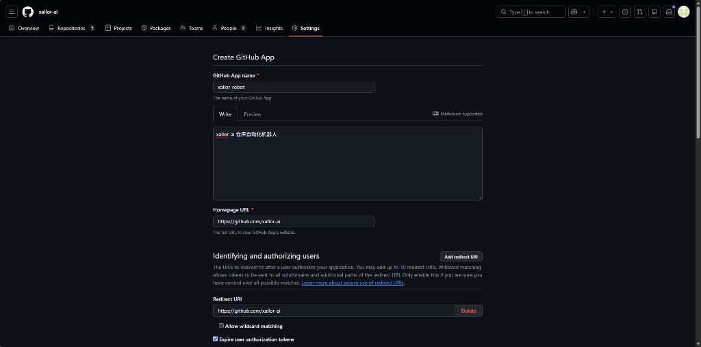
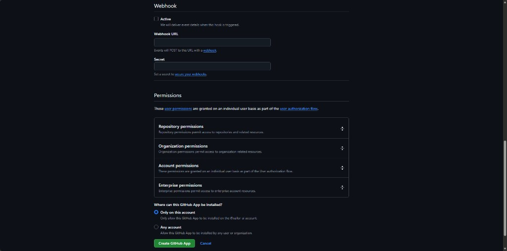
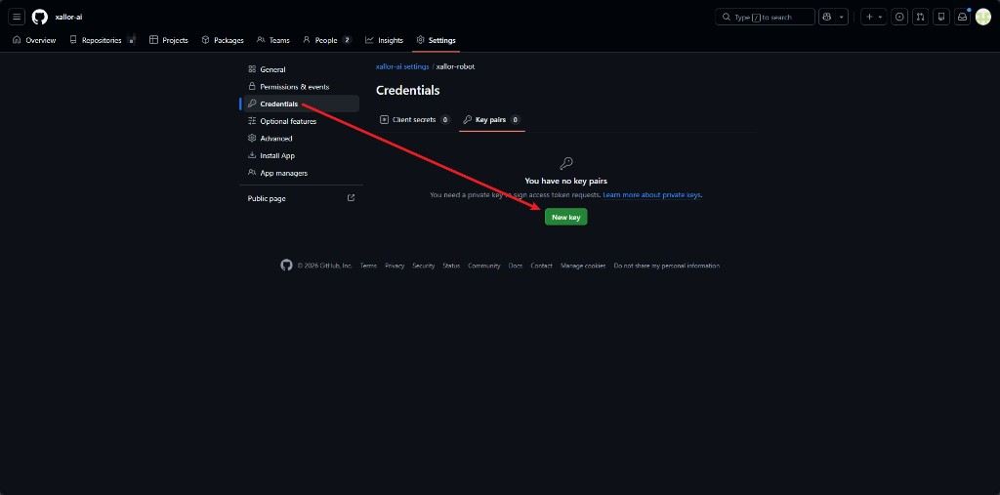

# 现代 GitHub：注册 GitHub App 并验证安装身份

> 本文收录于 [AI-Engineering-Notes](https://github.com/xallor-ai/AI-Engineering-Notes)，分享 AI 技术研究、工程实践与应用探索。欢迎 Star 关注后续更新，也欢迎通过 Issue 交流和纠错。

本篇是自建集成专题，前置为 [现代 GitHub：S2 通过 API 操作仓库对象](<现代 GitHub：S2 通过 API 操作仓库对象.md>)。目标是让一个独立机器人读取自己 `YOUR_LOGIN/resource-nav` 的 PR，并在你明确选择时发一条时间线评论。仅注册、下载私钥或看到安装存在，都不能证明 API 调用已经成功。

使用现成 Copilot 或 Cursor 服务的读者无需自建 App；按服务的安装与授权流程即可。这里不训练模型、不接收 Webhook，也不搭建公网服务。需要理解推送与验签时，另读 [现代 GitHub：S3 接收和验证 Webhook 事件](<现代 GitHub：S3 接收和验证 Webhook 事件.md>)。

## 为什么不继续用个人登录

在 API 专题中，评论属于 gh 登录用户。长期服务通常需要独立身份、清楚的仓库范围，以及能够单独撤销的授权。GitHub App 在账号下注册，再安装到某个账号并获准访问选定仓库；安装令牌的操作归属于 App。注册归属和安装目标是两个对象，即使本例都在你的个人账号下，也应分别核对。[安装身份说明](https://docs.github.com/en/apps/creating-github-apps/authenticating-with-a-github-app/authenticating-as-a-github-app-installation)

| 凭据路线 | 代表谁 | 本篇是否使用 |
| --- | --- | --- |
| gh 用户登录、PAT | 用户；权限仍受用户授权范围约束 | 不用于 App 调用 |
| OAuth App 用户令牌 | 授权该应用的用户 | 不使用 |
| GitHub App 用户令牌 | App 代表用户执行允许的操作 | 不使用 |
| GitHub App 安装令牌 | 安装到指定账号的 App | 本例路线 |

GitHub App 也能走用户授权，因此“用了 App”不自动意味着安装身份。我们不启用安装期间的用户 OAuth、不设置用户登录回调，也不用 Client secret 换用户令牌。私钥签出的 JWT 用于证明 App 身份，再申请 installation access token；后者才用来访问仓库 PR。[App 认证方式](https://docs.github.com/en/apps/creating-github-apps/authenticating-with-a-github-app/about-authentication-with-a-github-app)

## 注册时只给本例需要的能力

在自己的账号进入 Settings → Developer settings → GitHub Apps → New GitHub App，或打开 [个人注册入口](https://github.com/settings/apps/new)。组织注册需要相应管理权限；零基础练习不以组织管理员资格为前提。名称须全局唯一且不超过 34 字符。[注册文档](https://docs.github.com/en/apps/creating-github-apps/registering-a-github-app/registering-a-github-app)



保留的截图以 `xallor-robot` 为历史示意，不应原样复制账号或回调字段。为你的 App 起独立名称，Homepage URL 填真实练习仓库地址，如 `https://github.com/YOUR_LOGIN/resource-nav`。Callback / Redirect URI 留空；截图中的组织主页不是回调填写范本。Setup URL 可空，Request user authorization during installation 和 Device Flow 不勾选。



Webhook 的 Active 关闭，不订阅事件。主动读 PR 和写评论不依赖事件推送，因此这里也不需要 Webhook secret。未来若启用推送，secret 是独立的验签凭据，不能拿私钥或 API token 代替。

Repository permissions 只设 **Pull requests: Read and write**，Metadata 保持读取，其他仓库、组织和账号权限不授予。只读练习本可只给 Pull requests Read；这里为后面的单条 PR 评论预留写权限，脚本的 read 模式仍申请只读令牌。PR 时间线评论走 Issue comments API，该端点接受 Issues 或 Pull requests 写权限；本例只开后者，不开 Contents、Actions、Administration 或 Secrets。[评论端点](https://docs.github.com/en/rest/issues/comments#create-an-issue-comment)

安装范围选 **Only on this account**，创建 App。它限制谁能安装；随后安装页的 Only select repositories 才限制访问哪些仓库，两个“Only”不能互相替代。App 加权限后，既有安装还可能需要管理员批准更新；注册页已保存不等于安装权限已经扩展。[权限选择](https://docs.github.com/en/apps/creating-github-apps/registering-a-github-app/choosing-permissions-for-a-github-app)

## 安装与私钥是两份不同证据

在 App 设置的 Install App 选择自己的账号，只选 `resource-nav` 并安装。随后从 Installed GitHub Apps 或仓库 Settings → Integrations → GitHub Apps 的 Configure 检查账号、仓库范围和已批准权限。不要只确认页面出现了图标。

在 App 设置找到私钥管理区，生成并下载 `.pem`。不同界面版本可能显示 Private keys，或 Credentials → Key pairs → New key；以私钥生成功能为准。历史截图如下：



把私钥保存到仓库外的受控目录，例如个人配置目录中的专用子目录。它不是 Client secret，也不是可直接用来调 PR API 的 token。下载后不提交 Git，不贴到日志；丢失则生成新密钥并撤销旧密钥。[私钥管理](https://docs.github.com/en/apps/creating-github-apps/authenticating-with-a-github-app/managing-private-keys-for-github-apps)

Client ID、App ID、Installation ID 是标识符，不是秘密，但用途不同。Client ID 是下面 JWT 的 `iss`；Installation ID 标识一次安装。脚本会用 App JWT 请求当前目标仓库的 installation，以免从另一个账号的安装页抄错 ID。

## 从私钥到首次读取

签名 JWT 包含 `iat`、`exp`、`iss`。示例按官方建议把 `iat` 向前移 60 秒容忍时钟误差，`exp` 设在当前时间后 9 分钟，低于允许的未来 10 分钟上限，并使用 RS256。JWT 用于 App 级认证；安装 token 通常一小时后过期，响应的 `expires_at` 是本次判断依据。申请时还能将仓库和权限收窄，但不能扩大到安装未获准的范围。[JWT 规则](https://docs.github.com/en/apps/creating-github-apps/authenticating-with-a-github-app/generating-a-json-web-token-jwt-for-a-github-app) · [安装 token](https://docs.github.com/en/apps/creating-github-apps/authenticating-with-a-github-app/authenticating-as-a-github-app-installation)

下载 [app_practice.py](./_assets/modern-github/integration/app_practice.py) 到仓库外的本地练习目录。本例主体使用 Python 3.12 标准库 HTTP 客户端，RSA 签名交给 PyJWT 和 cryptography，不手写密码学算法。以下在该目录的 PowerShell 7 执行；虚拟环境只保存在本机，不作为文章附件或项目依赖提交。

```powershell
py -3.12 -m venv .venv
.\.venv\Scripts\python.exe -m pip install 'PyJWT[crypto]==2.10.1'
```

这里固定 PyJWT 示例版本，`crypto` extra 安装 RSA 所需依赖；不是声称固定了整个依赖树或证明所有依赖未来安全。运行方式依据 [PyJWT 2.10.1 RSA 文档](https://pyjwt.readthedocs.io/en/2.10.1/usage.html)。

将下面的登录名、PR 编号、Client ID 和私钥绝对路径替换为你的实际值。PR 必须已存在于自己的练习仓库，可从前面章节完成的 PR 中选一条；示例 `1` 并非保证存在。

```powershell
$repo = 'YOUR_LOGIN/resource-nav'
$prNumber = 1
$env:APP_CLIENT_ID = 'YOUR_APP_CLIENT_ID'
$env:APP_PRIVATE_KEY_PATH = 'C:\Users\YOUR_WINDOWS_USER\.config\github-app-lab\private-key.pem'
.\.venv\Scripts\python.exe .\app_practice.py read --repo $repo --pr $prNumber
```

脚本首先 GET `/app` 与目标仓库的 installation，确认 App ID 和安装账号。然后 POST 创建一个仅限 `resource-nav`、Pull requests read 的安装 token；这是生成短期凭据，不会发布评论。它检查令牌可访问的仓库列表，再 GET 指定 PR，输出 App slug、安装 ID、过期时间、权限、PR URL 和标题。token 与 JWT 只在进程内使用，不打印、不写文件。最后 DELETE `/installation/token` 撤销本次 token。[安装 API](https://docs.github.com/en/rest/apps/installations)

对公开仓库，单独读取仓库元信息不足以证明安装权限；匿名也能读取很多数据。本例把 App 身份、installation 归属、token 仓库列表和 PR 请求放在一起核对。若这些值不符合预期，应停止，不以“能读到公开 PR”掩盖选错安装。

## 明确选择一次评论，再按 ID 读回

read 模式成功后，先在浏览器确认输出的 PR URL。准备一份 UTF-8 正文文件，写明这是受控练习：

```powershell
$marker = 'app-lab-' + [guid]::NewGuid().ToString()
"安装身份练习：已核对本 PR 的目标仓库。标记：$marker" |
    Set-Content -LiteralPath .\comment.txt -Encoding utf8NoBOM
Get-Content .\comment.txt
```

下一条命令会公开发布评论。`--confirm` 必须精确等于仓库和 PR 编号；这不是 GitHub 的授权机制，而是示例避免误选目标的一道本地核对。实际授权仍由安装范围与 token 权限决定。

```powershell
.\.venv\Scripts\python.exe .\app_practice.py comment --repo $repo --pr $prNumber --body-file .\comment.txt --confirm "${repo}#$prNumber"
```

comment 模式重新获取仅限目标仓库的写 token，先读 PR，再调用 `/issues/{pr_number}/comments`。它先输出 Write receipt（状态码、评论 ID、URL），随后按该 ID GET 读回，检查正文与作者 `<app-slug>[bot]`，最后撤销 token。用回执 URL 打开网页，再核对同一 PR、作者和标记。普通时间线评论不会产生批准，也不是针对 diff 某行的 Review comment。

若写入后读回失败，或收到超时，不能直接重新执行整段命令：评论可能已存在。先看 Write receipt；若没有回执，在目标 PR 时间线查 `$marker`。这个脚本没有持久幂等存储，也不会自动重试 POST。`finally` 撤销失败会使程序报错，但不能据此认定评论没有发布。

401 时查 JWT 时间、Client ID 与私钥匹配；403/404 时同时查安装仓库、已批准权限和 PR 编号；限流时按响应要求等待。不要为解决一个失败把权限全部打开。只有明确取得回执并读回相同对象，才记录“本次评论成功”；本地能签出 JWT 仅证明本地算法执行了。

## 结束实践与返回主线

脚本正常结束会撤销自己创建的安装 token；若进程被强制结束，不能保证清理代码执行，需结合 `expires_at` 和安装管理采取措施。过期后重新读取应申请新 token，不能反复复用旧 token。撤销单个 token 不等于删除私钥，也不等于卸载 App。[撤销 token](https://docs.github.com/en/rest/apps/installations#revoke-an-installation-access-token)

不再需要实验身份时，在 Installed GitHub Apps 配置中移除练习仓库或卸载该 App；在 App 的密钥管理区撤销测试私钥，清理本机 `.pem` 与环境变量。需要保留 App 时只撤销不用的密钥，别误删其他集成正在使用的身份。评论作为已经产生的对象会继续存在，可从其网页菜单删除本次测试评论。若未来启用了 Webhook，还需另行关闭推送和服务。

```powershell
Remove-Item Env:APP_CLIENT_ID
Remove-Item Env:APP_PRIVATE_KEY_PATH
```

完成本篇后，你应能分别拿出注册配置、安装范围、首次读取和单条评论的证据，而不是用一张安装成功截图代替全部验证。第三方服务路线见 [现代 GitHub：S5 将协作方法迁移到 Cursor](<现代 GitHub：S5 将协作方法迁移到 Cursor.md>)；返回 [现代 GitHub：00 导读](<现代 GitHub：00 导读.md>) 可继续 AI 协作主线。
