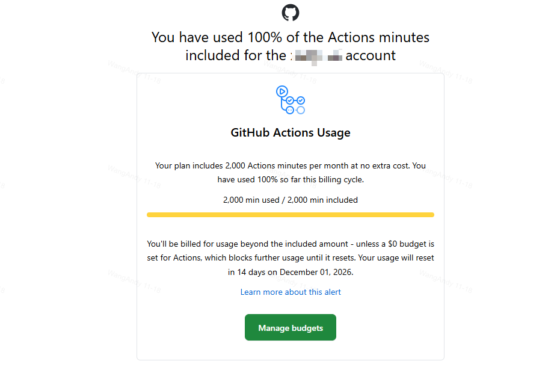

# 现代 GitHub：附录 A Self-hosted Runner

> 本文收录于 [AI-Engineering-Notes](https://github.com/xallor-ai/AI-Engineering-Notes)，分享 AI 技术研究、工程实践与应用探索。欢迎 Star 关注后续更新，也欢迎通过 Issue 交流和纠错。

本书执行环境专题。[全书导读](<现代 GitHub：00 导读.md>) · [Actions 基础](<现代 GitHub：08 让每个 PR 接受自动检查：Actions、CI 和合并门禁.md>)。前置是能手动运行 workflow 并理解 job 与 runner；本专题另用私有 runner-lab，结束后返回公开 resource-nav 主线。

你已经有一台能运行测试的电脑，但 GitHub 提供的机器没有所需 SDK，内存不够，或者个人私有项目的托管计算额度已经用完。Self-hosted Runner 可以把 job 放到自己的机器上执行，同时继续在 GitHub 查看日志与状态。

本篇从 Windows x64 的前台 Runner 开始，跑通一个小型单元测试，再讲如何迁移自己的重型 CI、注册成服务以及停止使用。小测试用来验证调度与环境，不用它声称已经证明大规模测试的性能。

资料核对日期：2026-11-18。下载版本、支持系统和计费以链接中的官方文档及设置页为准。

## 1. 先把自己的需求对应到执行方式

| 需求 | 自托管解决什么 | 配置时真正需要确认什么 |
| --- | --- | --- |
| 特定编译器、商业 SDK、驱动、内网服务 | job 可以使用自己维护的工具链与网络 | 运行 Runner 的账号能否访问依赖、许可和路径 |
| 个人 CI 需要更多 CPU、内存、磁盘或 GPU | 使用本机的实际硬件资源 | 容量是否足够；测试并发是否影响桌面使用；GPU 驱动与框架是否匹配 |
| 私有项目的托管计算额度不足 | 选择 self-hosted 的 job 不消耗托管 runner 计算额度 | 先在仓库所属账号/组织的计费与 Actions 用量页区分计算、存储和其他产品用量 |
| 本机已有大数据集或耗时依赖环境 | 可以预先准备受控的本地资源 | 数据版本、清理策略和权限是否明确，不能依赖上次 job 偶然留下的状态 |

当前官方计费说明将 self-hosted runner 列为不消耗包含计算用量的使用方式；公开仓库的标准 GitHub-hosted runner 也在免费范围内。因此，遇到公开仓库任务失败不能直接推断“免费分钟用完”。Artifact/cache 存储有自己的计量，改成自托管不会自动免除这些费用；电费、硬件、网络和维护成本由自己承担。[Actions 计费](https://docs.github.com/en/billing/concepts/product-billing/github-actions)

### 额度耗尽时的页面信号

下面是一张账户用量通知截图：页面明确显示本计费周期已使用 100% 的 Actions 分钟，并提示后续用量可能计费或被预算设置阻止。它适合帮助你识别“额度耗尽”这一真实场景；截图中的账户、分钟数和重置日期只属于该账户和计费周期，不是所有 GitHub 账户的固定套餐结论。



*示例截图：具体额度、预算、重置时间和是否允许继续使用，以自己账号的 Billing/Actions 用量页面为准。Self-hosted Runner 改变 job 的执行位置，不会自动消除 artifact、缓存、组织预算或其他产品用量。*

普通短测试且托管环境已满足要求时，继续使用托管 runner 通常更省维护。自托管的价值在于把已有资源和特殊环境接入 CI；它不保证更快，也不会自动为任务补足内存或安装驱动。

## 2. GitHub 调度，本机执行

一次运行仍是：事件触发 workflow → GitHub 创建 job → 匹配可用 Runner → Runner 执行 steps → 日志和退出状态回传 GitHub。

Runner 是在本机运行的程序，不是你的编辑器。`actions/checkout` 把本次提交取到 Runner 的工作目录；它不会自动测试桌面 checkout 中尚未提交的修改。Runner 以其操作系统账号的权限执行命令，workflow 的 `permissions` 只限制 GitHub token，不限制本机文件或网络访问。

本机必须开机、保持联网、避免休眠，并运行 Runner 程序。Runner 主动连接 GitHub，通常不需要公网入站 IP；防火墙或代理仍需允许官方列出的出站 HTTPS 端点，下载 action、依赖和上传产物还会访问其他端点。[通信与运行要求](https://docs.github.com/en/actions/reference/runners/self-hosted-runners)

### 本附录使用独立的私有实验仓库，不是主线必做步骤

不要把日常个人电脑注册到本书公开的 resource-nav 实验仓库或其他公开 fork。GitHub 官方建议自托管 Runner 只用于私有仓库；私有仓库也不自动保证代码可信，协作者提交和第三方 action 同样会在机器上执行。[官方安全提示](https://docs.github.com/en/actions/how-tos/manage-runners/self-hosted-runners/add-runners)

在自己的 GitHub 账号新建 **Private** 仓库 `runner-lab`，勾选初始化 README，确认默认分支；下文固定使用 `main`。若账号创建的默认分支不是 main，可在这个全新的私有实验仓库中先重命名默认分支，或在本文所有分支引用处一致使用实际名字。它是本模块专用仓库，结束后回 resource-nav 主线学习第 8 章，不复制整套现有公开 workflow 进来。

首轮只允许手动触发，不配置 `pull_request`、`pull_request_target` 或接收外部输入的脚本。用自己确认过的提交和 action，优先选择独立机器或专用账号，避免使用保存生产密钥的工作环境。手动触发减少意外运行，但不构成沙箱；有权改 workflow 的人仍可能让它执行其他命令。

## 3. 准备 Windows 的实际执行环境

本例使用受支持的 Windows x64 系统，Git 和 Python 3.12。准备至少可容纳代码与测试输出的磁盘空间。注册个人仓库 Runner 需要仓库 owner；组织仓库需要相应 owner/admin 权限，组织还可能限制仓库注册 Runner。[注册权限与 Windows 要求](https://docs.github.com/en/actions/how-tos/manage-runners/self-hosted-runners/add-runners)

先以将要运行前台 Runner 的普通账号打开 PowerShell，执行：

```powershell
git --version
py -3.12 --version
py -3.12 -c "import sys; print(sys.executable)"
```

若找不到 Git 或 Python，先安装官方 Windows 版本并重新打开终端；不要用一个失败的安装环境继续注册测试。记下最后一行的 **python.exe 完整路径**，下一步将作为仓库变量使用。若没有 py 启动器，也可直接用已安装 Python 的完整路径执行同样的版本检查。

还要检查同一账号的 Windows PowerShell 脚本执行策略：Runner 会将 run 步骤写成临时 `.ps1` 文件，终端里能逐行执行命令，不代表能够运行脚本文件。

```powershell
Get-ExecutionPolicy -List
Get-ExecutionPolicy
```

如果有效策略是 Restricted，个人自管电脑可先记下 CurrentUser 原值，再以 Runner 账号执行 `Set-ExecutionPolicy -Scope CurrentUser -ExecutionPolicy RemoteSigned`，重新查询有效策略。RemoteSigned 允许本机生成的脚本运行，对来自互联网的脚本另有签名要求；不必把整机策略改成 Unrestricted。若 MachinePolicy/UserPolicy 已由组织管理，按组织要求申请配置，不通过更低作用域绕过它。切换服务账号时要重新核查该账号，个人账号的设置不会自动转移。[PowerShell 执行策略](https://learn.microsoft.com/en-us/powershell/module/microsoft.powershell.core/about/about_execution_policies?view=powershell-5.1)

在 runner-lab 的 Settings → Secrets and variables → Actions → Variables 中新增 `PYTHON_EXE`，值为刚得到的路径，例如 `C:\Tools\Python312\python.exe`。这个路径示例不能原样照抄；路径不是密钥，不需要放 Secrets。

本例刻意使用现有解释器，帮助确认 job 确实在使用你的环境；后续若换成 setup-python 等 action，要另外核查该 action 的自托管平台、工具缓存和权限要求，不能假定本机预装工具与 ubuntu-latest 相同。

## 4. 下载、注册并启动 Runner

打开 **runner-lab → Settings → Actions → Runners → New self-hosted runner**，选择 Windows 和 x64。页面会生成当前版本下载、解压、校验和注册命令。

1. 在磁盘中准备专用目录，例如 `C:\actions-runner`，不要放进笔记库或项目 checkout。若创建此目录需管理员权限，由管理员创建并只给 Runner 账号所需访问权。
2. 在 PowerShell 进入该目录，按页面给出的 Windows 下载命令和哈希校验步骤执行；不要跳过页面提供的完整性检查。目录中应出现 config.cmd 和 run.cmd。
3. 执行页面生成的注册命令。下面只展示结构，URL 与临时 token 必须取自刚打开的 runner-lab 页面：

```powershell
Set-Location -LiteralPath 'C:\actions-runner' -ErrorAction Stop
Get-Location
.\config.cmd --url https://github.com/YOUR_LOGIN/runner-lab --token REPLACE_WITH_REGISTRATION_TOKEN
```

4. 按交互提示，Runner 名称填 `lab-win-x64`，附加标签填 `lab-windows`，工作目录保留 `_work`。首次练习在“是否作为服务运行”处选择否；不要用 `--replace` 覆盖已有 Runner。
5. 注册成功后启动：

```powershell
.\run.cmd
```

注册 token 是临时注册凭据，官方说明有效期为一小时；它不是 PAT，也不是 job 的 GITHUB_TOKEN。过期就回页面取得新命令，不把 token 写进 workflow、笔记或截图。Runner 注册后持有自己的连接凭据，目录中的隐藏配置也不要公开。

终端出现 `Connected to GitHub`、`Listening for Jobs` 后保持窗口打开。回到 Settings → Actions → Runners，应看到 `lab-win-x64` 为 Idle；Offline 表示未连接，Busy 表示正在执行。

### 用标签指定这台机器

本篇 job 使用：

```yaml
runs-on: [self-hosted, windows, x64, lab-windows]
```

前三项是本例正常注册时的默认标签，最后一项是刚添加的自定义标签。Runner 必须同时匹配全部标签，且对当前仓库可用。标签是路由条件，不会安装 Windows、Python 或 GPU 驱动，也不是访问控制边界。多台机器若都有这些标签，job 可以落到任意一台可用机器；要指定本机，就让 lab-windows 只标在这台实验 Runner 上。[标签路由](https://docs.github.com/en/actions/how-tos/manage-runners/self-hosted-runners/use-in-a-workflow)

## 5. 跑通一个本机单元测试

本节所有文件都在 **runner-lab**，不写进公开的 resource-nav 或本书源仓库。通过 GitHub 网页或本地 Git，从 main 创建 `lab/self-hosted-ci`，添加两个文件。

`app.py`：

```python
def square(value):
    return value * value
```

`test_app.py`：

```python
import unittest
from app import square


class SquareTests(unittest.TestCase):
    def test_positive(self):
        self.assertEqual(square(3), 9)

    def test_negative(self):
        self.assertEqual(square(-2), 4)


if __name__ == "__main__":
    unittest.main()
```

再添加 `.github/workflows/local-ci.yml`。它只手动运行，只接受默认示例分支 main，使用 Windows PowerShell，不依赖本机另装 PowerShell 7：

```yaml
name: Local Windows CI
on:
  workflow_dispatch:
permissions:
  contents: read
concurrency:
  group: local-windows-ci
  cancel-in-progress: false
jobs:
  test:
    if: github.ref == 'refs/heads/main'
    runs-on: [self-hosted, windows, x64, lab-windows]
    timeout-minutes: 20
    defaults:
      run:
        shell: powershell
    env:
      PYTHON_EXE: ${{ vars.PYTHON_EXE }}
    steps:
      - name: Checkout reviewed revision
        uses: actions/checkout@v7
        with:
          persist-credentials: false
      - name: Check local environment
        run: |
          Write-Output "Runner=$env:RUNNER_NAME OS=$env:RUNNER_OS Arch=$env:RUNNER_ARCH"
          if (-not $env:PYTHON_EXE -or -not (Test-Path -LiteralPath $env:PYTHON_EXE -PathType Leaf)) {
            throw "Set PYTHON_EXE to an accessible python.exe path"
          }
          & $env:PYTHON_EXE --version
          if ($LASTEXITCODE -ne 0) { exit $LASTEXITCODE }
      - name: Run unit tests
        run: |
          & $env:PYTHON_EXE -m unittest discover -v
          if ($LASTEXITCODE -ne 0) { exit $LASTEXITCODE }
```

reviewed revision 是步骤名称，不是自动审查机制。创建面向 runner-lab 的 main 的 PR，检查文件和 action 引用后合并。此时没有自动 CI 是预期行为，因为只声明了 workflow_dispatch。

现在进入 Actions → Local Windows CI → Run workflow，选择 main 并运行。检查以下对应关系：

- GitHub 的 run 对应刚合并的提交，test job 被分配给 `lab-win-x64`。
- 本机终端显示开始处理该 job，GitHub Runner 页面暂时显示 Busy。
- 环境步骤打印 Runner 名称、系统、架构和 Python 版本；测试日志显示发现并通过两个测试，随后 Runner 回到 Idle。

日志中的测试输出和绿色结论才说明这次测试完成。注册成功或 Idle 只证明机器可接收任务。没有在线且标签匹配的空闲 Runner 时，job 会排队，不会自动退回 ubuntu-latest；当前官方说明 self-hosted job 排队超过 24 小时会失败。[调度行为](https://docs.github.com/en/actions/reference/runners/self-hosted-runners)

### 确认失败也能回传

从最新 main 新建 `lab/break-local-ci`，把 square 的返回值临时改成 `value + value`，不改测试。检查并合并这个实验 PR，再手动运行 main。两个测试应失败，命令非零退出，job 显示失败。本例显式检查 `$LASTEXITCODE`，避免 Windows 脚本忽略原生命令的失败。

再从 main 建立修复分支，将函数恢复为乘法，经 PR 合并后运行新提交，结果应恢复通过。这里是在专用私有仓库验证失败传播，不要把故意破坏测试的提交合入正式项目。

手动运行可以在 Actions 展示结果，但本例没有自动 PR 检查，不能直接把它当作合并前必需检查。第 8 章仍在 resource-nav 使用托管 Runner 学习 CI 门禁。

## 6. 将真正的 CI 接到本机

小测试通过后，再迁移实际项目中的一个 job。先记录原来的命令、系统、依赖版本、测试数量与耗时，确定本机缺哪些条件，再在该私有项目注册仓库级 Runner 或由管理员授权组织 Runner。

### 个人 CI 太大，或托管计算额度不足

先把最耗资源的 job 切到本机标签，保留其他 job 原来的 runs-on。每个 job 单独选择 runner，安装一个 Runner 不会自动接管所有 workflow，也不会取消其余托管 job 的计费。

若该项目完全由自己或可信协作者维护，希望合并后自动跑 CI，可以把 local-ci.yml 的 on 部分替换为：

```yaml
on:
  workflow_dispatch:
  push:
    branches: [main]
```

修改经 PR 合入 main 后，应出现 push 事件的 run。原来的 job.if 与标签保持一致。这仍是合并后检查；要做自动 PR 门禁，需要另行评估哪些分支提交者能执行本机代码、设置所需事件与规则，不能机械复制公开仓库的 pull_request 配置。

先用小批测试验证，再逐步增加真实数据量与并发。示例的 timeout-minutes 为 20；迁移重任务时，根据实际耗时设置合理的超时，并核查 Actions 当前的 job 时长限制，避免把正常长任务提前取消。单个 Runner 进程通常串行处理 job，matrix 会创建多个 job，并不会让一台机器自动获得更多执行槽位。不要为了消除 queued 在同一台个人电脑上注册大量 Runner，造成 CPU、内存和磁盘争用。

### 使用特殊 SDK、内网数据或 GPU

将环境检查放在重任务前，失败就停止。例如 SDK 路径和版本、数据目录是否可读、依赖服务能否连接。通过 PYTHON_EXE 绑定已准备好的项目虚拟环境；从 requirements 或锁文件安装依赖时使用这个解释器，不依赖管理员终端里的另一套 pip。

对于 NVIDIA CUDA 项目，可在同一个 Runner 账号下检查 nvidia-smi，并用项目解释器验证框架是否能看到设备。下面是已有 PyTorch 项目的步骤片段，不加入上述标准库例子：

```yaml
      - name: Check CUDA for this project
        run: |
          & $env:PYTHON_EXE -c "import torch; assert torch.cuda.is_available(), 'CUDA unavailable'; print(torch.cuda.device_count())"
          if ($LASTEXITCODE -ne 0) { exit $LASTEXITCODE }
```

MUSA、ROCm 等环境使用对应厂商驱动与框架检查，不照抄 torch.cuda。设备可见只证明环境入口可用；还需用小型计算验证，再执行实际测试。按需要增加 gpu 等自定义标签，并同时更新 job 的标签列表。标签不会自动检查设备健康或空闲显存。

若实际 CI 使用 Linux shell、CUDA Linux 工具链、Docker container action、job container 或 service container，选择 Linux Runner。GitHub 的容器工作流要求 Linux 与 Docker；Windows 安装 Docker Desktop 不会把 Windows Runner 变成 Linux Runner。在 Windows run 步骤里手动调用 docker 是另一种用法，不等于支持上述容器机制。[Runner 平台要求](https://docs.github.com/en/actions/reference/runners/self-hosted-runners)

一个 job 调用 torchrun 或集群调度器可以启动分布式任务，但注册 Runner 本身不会配置多机网络、节点资源、通信库或集群权限。本篇先解决把已可用环境接入 CI，不将集群部署混入安装步骤。

## 7. 长期使用时注册为 Windows 服务

前台模式关闭窗口、退出登录或停止进程后 Runner 就离线。长期使用可以让服务随开机启动，但休眠、断网和关机仍会中断执行。

Windows 的服务选项属于 config.cmd 注册过程；如果刚才选了前台模式，需要先按下一节的移除命令解除注册，再取得新的注册 token，重新配置并选择服务。本次只是重注册，保留安装目录、原 workflow 和 runs-on；若为维护临时禁用了 workflow，注册完成后先重新启用，再验证。不要照搬 Linux 的 svc.sh。[服务模式说明](https://docs.github.com/en/actions/how-tos/manage-runners/self-hosted-runners/configure-the-application)

1. 等 job 结束，停止前台 run.cmd，按下一节完成移除。
2. 以管理员 PowerShell 进入 Runner 目录，使用 Settings 页面新生成的 config.cmd 命令重新注册，保留所需标签；在服务提示处选择是。
3. 核对实际服务运行账号。安装服务需要管理员权限，不意味着 job 应使用拥有管理员权限的个人账号；选择仅有必要目录、工具和网络访问权限的账号。
4. 打开 Windows 服务管理器，找到名称以 actions.runner. 开头且对应 runner-lab 的服务，确认运行账号、启动类型与运行状态。
5. 回 GitHub 看 Idle，再运行同一个诊断和 UT workflow。只有服务模式下也通过，才能认为切换完成。

可用管理员 PowerShell 查询服务，并在确认名称后操作单个服务：

```powershell
Get-Service -Name 'actions.runner.*' | Select-Object Name, Status, StartType
# 将下一行改成上面看到的、属于本次实验的完整服务名
$runnerServiceName = 'REPLACE_WITH_EXACT_SERVICE_NAME'
Start-Service -Name $runnerServiceName
Get-Service -Name $runnerServiceName
# 暂停接收任务前，先确认当前 job 已结束
Stop-Service -Name $runnerServiceName
```

脚本最后一行会停止服务；首次验证前只执行查询和启动部分。不要用通配符批量停止同机其他仓库的 Runner。服务账号未必能访问你的用户目录、映射盘、证书或虚拟环境；若前台通过、服务失败，首先检查这些差异。修改系统 PATH 后也要重启 Runner 服务，使其取得新环境。

## 8. 排错、维护与退出

| 现象 | 先检查什么 |
| --- | --- |
| Runners 页面 Offline | run.cmd/服务是否运行，电脑是否休眠，出站连接或代理是否阻断 |
| Idle 但 job queued | job 的全部标签、仓库访问范围、Runner group 权限；不是只看 self-hosted 一个标签 |
| Python/Git 找不到 | job 实际服务账号、PYTHON_EXE 的完整路径与访问权限；不要只看自己终端能否运行 |
| 提示 running scripts is disabled | 按第 3 节检查实际 Runner 账号的有效 PowerShell 执行策略；交互命令成功不代表 .ps1 可执行 |
| Windows 命令报语法错 | workflow 的 shell 是否与命令一致；Bash 的 export/路径语法不能原样放进 PowerShell |
| 重跑才通过或读取旧文件 | 检查工作区和机器状态残留，显式重建生成目录或使用项目隔离环境 |
| GPU 可见但测试失败 | 框架/驱动版本、显存、其他进程占用及测试规模 |
| 托管任务仍因额度失败 | 是否只改了某个 job；其他 job 是否还用托管 runner，或失败的是存储、预算与政策限制 |
| 更新后 action 无法运行 | Runner 是否更新、action 的最低 Runner/系统要求是否满足 |

Runner 应用默认自动更新，操作系统、Python、驱动和其他工具仍由你维护。每次更新后保留一次小型 CI 检查。自托管环境不保证每个 job 都是干净实例；checkout 清理仓库也不会重置整台电脑。项目工作区之外的文件、进程和凭据要按实际需要管理，清理前确认范围，不执行针对整盘的通用删除命令。[自托管维护职责](https://docs.github.com/en/actions/concepts/runners/self-hosted-runners)

临时停止：在 Actions 取消或等待当前 run 结束，然后对前台 Runner 按 Ctrl+C，或停止对应 Windows 服务。确认 GitHub 显示 Offline。取消 run 后核对本机测试进程是否已退出，尤其是启动了外部服务或子进程的任务。

永久移除：先停用使用它的 workflow，或把相应 job 改回合适的 runner；然后 Settings → Actions → Runners → 点击本次 Runner → Remove，按页面给出的实时移除命令在安装目录执行。服务模式请使用管理员 PowerShell，以便卸载对应服务。命令形式如下：

```powershell
Set-Location -LiteralPath 'C:\actions-runner' -ErrorAction Stop
Get-Location
.\config.cmd remove --token REPLACE_WITH_REMOVAL_TOKEN
```

移除 token 也从页面获取，不复用注册示例。确认网页不再列出该 Runner，服务模式还要确认对应服务已移除。本机目录可能仍有工作副本、日志和缓存；确认无需保留且服务/进程均已停止后，再清理本次 Runner 专用目录。单纯删 GitHub 的记录不能证明本机所有数据都已清除。[移除 Runner](https://docs.github.com/en/actions/how-tos/manage-runners/self-hosted-runners/remove-runners)

如果仅为本实验修改了 CurrentUser 执行策略，结束后可在同一账号下用 Set-ExecutionPolicy 将该作用域恢复为第 3 节记录的原值；不要覆盖其他用途后来需要的配置。

学完本篇后，已有的调度平台没有变化：GitHub 仍记录事件、run、job 和检查结果。改变的是命令实际运行的位置，以及由谁维护那台机器。回到[CI 与合并门禁](<现代 GitHub：08 让每个 PR 接受自动检查：Actions、CI 和合并门禁.md>)时继续使用 resource-nav 及其托管 Runner；只有确认需要且能维护自托管环境的项目，才迁移真实 CI。

